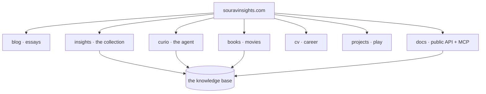
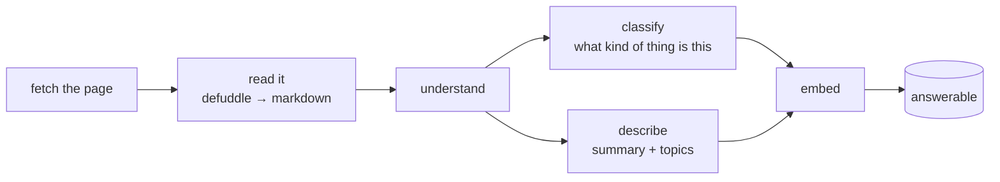

<div align="center">
  <a href="https://www.souravinsights.com">
    
  </a>
  <h1>souravinsights.com</h1>
  <p><strong>The operating system I run my work and my curiosity on.</strong></p>
  <p>Essays, a knowledge base of everything I read, an agent that answers from it, a reading shelf, films, my CV, and a few small things I built when a question got out of hand.</p>
  <p>
    <a href="https://www.souravinsights.com">Site</a> |
    <a href="https://www.souravinsights.com/blog">Writing</a> |
    <a href="https://www.souravinsights.com/insights">Insights</a> |
    <a href="https://www.souravinsights.com/curio">Curio</a> |
    <a href="https://www.souravinsights.com/docs">API</a>
  </p>
</div>

---

This stopped being a personal site somewhere along the way. It is where I write, where I keep everything I read, where I look for the thing I saved months ago, and where I ask questions I do not have the answer to yet. The useful way to think about it is an operating system: a few surfaces over one body of knowledge, with an agent that can reach all of it.



## The surfaces

| Surface | What it is |
| :--- | :--- |
| **Writing** (`/blog`) | Essays, kept as MDX and rendered statically |
| **Insights** (`/insights`) | Every link I have saved, grouped by what it is, with a reader and an ask panel |
| **Curio** (`/curio`) | The agent with a page of its own, for when asking is the point |
| **Shelves** (`/books`, `/movies`) | What I have read and watched |
| **CV** (`/cv`) | The professional half, with a PDF |
| **Projects and play** | Side projects, and toys that live in the footer |
| **Docs** (`/docs`) | How to query the collection from a script, a notebook or an MCP client |

## The collection

I save things constantly: articles, tools, people whose work I follow, publications, galleries, courses, directories. All of it worth keeping and most of it impossible to find again, which is a silly problem to have.

Old search made it worse. I would remember "the article about why nested rounded corners look wrong" and match nothing, because the article is called *Corners are relative* and search only looked at titles.

So every saved page is read once and understood, and its markdown is kept on the row:



Keeping the markdown is what makes the collection maintainable: the way a page is understood can change, and the whole collection can be re-decided without fetching anything twice.

Three things come out of each page, each with a job:

- **The category** says what a link *is*: article, publication, people, inspiration, tool, learning, directory, other. It is a filter on the page, and it decides how much of a page becomes searchable.
- **The summary** is the page in its own voice, two or three sentences. It becomes the card you read, the text the agent quotes, and it is what makes a gallery or a personal site answerable at all.
- **The topics** are for joining links together, so a topic that can only ever sit on one link is treated as noise. A small policy file decides which survive, and it is the one place the rules for topics live.

The agent answers only from what it retrieves, so it cannot cite a link that does not exist, and it says when the collection does not cover something instead of guessing. The reader opens any article inside the site from the stored markdown, with notes and highlights that persist. Two scheduled jobs keep the rest honest: one checks that links are still alive, the other re-reads a slice of the collection so pages that changed do not stay stale.

## Working on it

```bash
yarn install
cp .env.example .env        # fill DATABASE_URL and OPENROUTER_API_KEY first
npx drizzle-kit push        # create the schema
yarn dev
```

The collection has its own small toolbox, all run by hand:

| Command | What it does |
| :--- | :--- |
| `npx tsx scripts/kb-build.ts` | Reads and understands anything unfinished |
| `npx tsx scripts/kb-build.ts --stale` | Re-decides everything an older prompt version decided |
| `npx tsx scripts/kb-classify-probe.ts` | Scores a prompt or model against my own verdicts, without writing |
| `npx tsx scripts/kb-ask.ts "question"` | Puts a question through the real agent |
| `npx tsx scripts/kb-topics-test.ts` | The topic rules, offline |
| `npx tsx scripts/kb-suggestions.ts` | Rewrites the suggestion chips from the collection |
| `npx tsx scripts/kb-report.ts` | The state of the index: what is thin, what is unread |

## Reading the code

- **`docs/spec/`** is what got built and why, including the places the build disagreed with the plan.
- **`docs/review/`** is the critique of the collection's first design, and the record of every category decision.
- **`/docs` on the live site** explains the public API, the MCP server and the feeds.

## Built with

Next.js App Router and TypeScript. Tailwind and shadcn/ui for the interface, Framer Motion for the small animations, TanStack Query for client data. Postgres with pgvector for the collection, Drizzle for the schema, Upstash Redis for likes and rate limits, Trigger.dev for the scheduled jobs, OpenRouter for the models.
