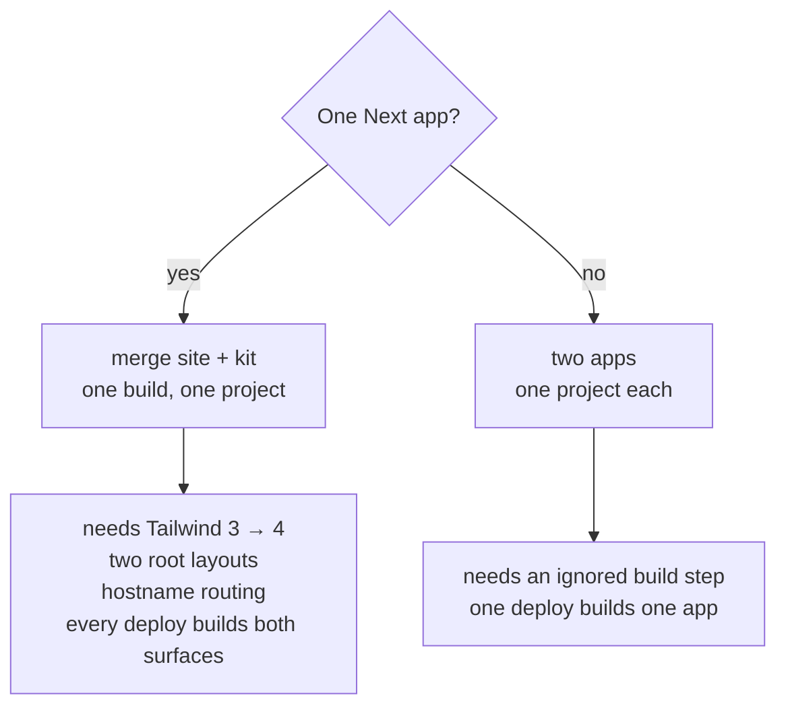

# Deployment Plan

Make a deploy fast and make one repo one pipeline — without changing what the
site looks like or how the kit installs.

## Baseline (measured)

| | Site | Kit |
| :--- | ---: | ---: |
| install | 146s | 171s |
| compile | **143s** (webpack) | 23s (Turbopack) |
| other build work | 98s | 15s |
| cache upload | 718 MB | 680 MB |
| **total** | **7m** | **3.7m** |

Two costs, both independent of the monorepo:

1. **Install.** Yarn 1 re-links the whole workspace every deploy. Vercel
   installs from the repo root, so *each project installs both apps*.
2. **Compile.** The site is Next 14, which still uses webpack (143s). The kit is
   Next 16 with Turbopack (23s). This is the single biggest build cost.

The build cache only sometimes warms the install — hence 12s one deploy and
380s the next.

## What to change

### 1. Unify on Next 16 + React 19

Upgrade the site from Next 14/React 18 to Next 16/React 19. This buys
Turbopack (143s → ~25s of compile) and removes the split that forced
`nohoist`, the two React majors and the tsconfig `react` mappings.

Known migrations, all documented:

- `cookies()` / `headers()` → `await` (9 call sites).
- `experimental.serverComponentsExternalPackages` → `serverExternalPackages`.
- `experimental.instrumentationHook` → stable (drop the flag).
- `images.domains` → `remotePatterns` (already partly done).
- `experimental.externalDir` → removed; confirm the MDX/registry paths still
  resolve.
- `@next/mdx` + `rehype-pretty-code` under Turbopack; verify code blocks.

The site keeps **Tailwind 3**. Tailwind version is independent of Next, so this
step does not touch styling.

### 2. Replace Yarn 1

Once both apps are React 19, hoisting is safe again and `nohoist` can go. Two
options, both modern:

| | Install | Isolation | Notes |
| :--- | :--- | :--- | :--- |
| **pnpm** | fast | strict, per-package | safest default; needs `onlyBuiltDependencies` for `sharp`/`esbuild`/`@tailwindcss/oxide` |
| **bun** | fastest | hoisted | already used by Rinze; needs `trustedDependencies` |

Pick one after a local install-time measurement; both should land near 20–30s.

### 3. One pipeline, one build per push

Each project gets an **Ignored Build Step** so a push builds only the app it
touched. Registry changes rebuild both.

```sh
[ -z "$VERCEL_GIT_PREVIOUS_SHA" ] && exit 1
git diff --quiet "$VERCEL_GIT_PREVIOUS_SHA" HEAD -- . ../../packages/registry
```

Exit 0 skips, non-zero builds. Verify whether Vercel runs it from the app root
or the repo root and adjust the paths.

### 4. Keep the Turbo remote cache

Vercel already runs it. With a fast install and a cache hit, an unchanged app
deploys in seconds.

## One project or two?



The blocker for one app is styling, not React: the kit is **Tailwind 4**
(Fumadocs 16 requires it) and the site is **Tailwind 3**. One Next build runs one
PostCSS pipeline, so merging means migrating the whole site to Tailwind 4 first —
a real project that touches every styled component, which is exactly what
"without breaking anything" forbids right now.

Merging also makes deploys *slower*, not faster: one app builds both surfaces on
every push. The speed comes from pnpm + Turbopack + the ignored build step, not
from the project count.

**Recommendation: stay two apps, one project each, fast.** This is the standard
Vercel monorepo shape, not a workaround. The two projects become invisible once
one push builds one app.

**If you want one project anyway**, the order is: Next 16 + React 19 → Tailwind 4
migration on the site → merge into one app with `(site)` and `(kit)` route groups
and hostname routing on `apps/site` → delete the kit project. That is a separate
plan; it is slower per deploy and much riskier.

## Target

| | Now | After |
| :--- | ---: | ---: |
| install | 146–171s | ~20–30s |
| compile | 143s / 23s | ~25s / ~25s |
| builds per push | 2 | 1 (or 0) |
| site deploy | 7m | ~90s |
| kit deploy | 3.7m | ~65s |

## Phases

1. **Upgrade the site.** Next 16 + React 19, webpack → Turbopack. No styling or
   feature changes. Pass: `typecheck`, `build`, and a visual check of the home,
   blog, insights, books and gallery routes. Record the new compile time.
2. **Migrate the package manager.** pnpm or bun; remove `nohoist` and the
   tsconfig `react` mappings. Pass: both apps typecheck and build; record
   install time.
3. **Ignored build steps.** One push → one build; a registry change → two.
4. **Confirm.** One cold deploy per project, timed end to end.

Each phase is one PR and is revertible on its own. Phases 1 and 2 are the speed;
phase 3 is the "one pipeline" feel.

## Risks

- **Turbopack + MDX.** `@next/mdx`, `rehype-pretty-code` and the registry aliases
  must compile. Verify code blocks and the blog before merging phase 1.
- **Next 16 removals.** `images.domains`, `externalDir` and the experimental
  flags are the likely build errors; the upgrade codemod handles most.
- **Strict installs.** pnpm can surface phantom dependencies the site never
  declared. Fix by declaring them; do not fall back to hoisted linking.
- **Cache size.** 700 MB uploads persist. Narrow Turbo `outputs` if so.

Rollback is per phase: revert the phase PR. Vercel detects the package manager
from the lockfile, so reverting phase 2 restores Yarn.

## Non-goals

- No visual redesign, no Tailwind upgrade unless we choose one app.
- No self-hosted runners or external CI.
- No change to the registry's public URLs.
