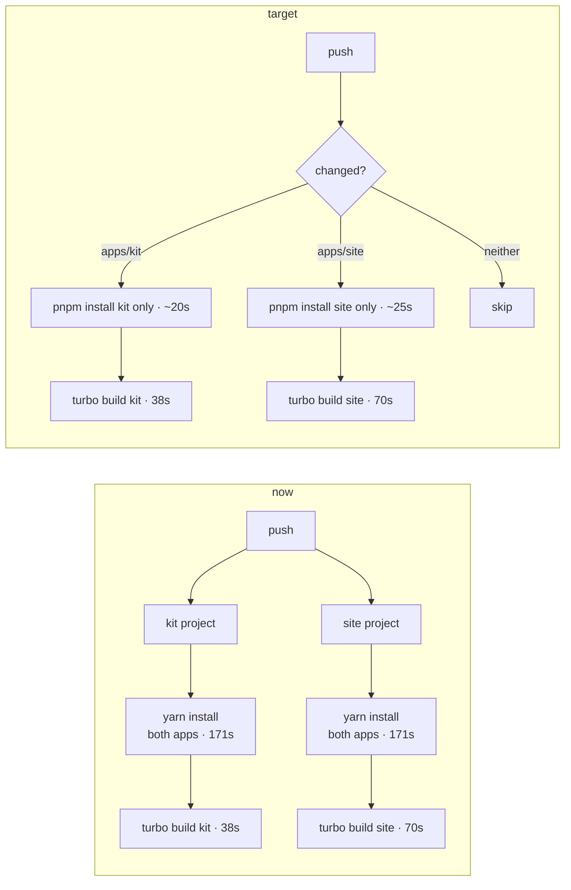

# Deployment Plan

Make a deploy fast (under ~90s) and make a push build only the app it touched.
No app changes, no broken deploys.

## Where the 4 minutes go

From the kit's production build log
(`dpl_31og8mrw`, `a2b610f`, 223.8s):

| Phase | Time | Notes |
| :--- | ---: | :--- |
| `yarn install` | **171s** | whole monorepo, both apps' deps |
| `turbo run build` (kit) | 38s | Next 16 + Turbopack |
| cache upload | ~2m | 680 MB, after deploy |

The app build is already fine. The install is the tax. Yarn 1 with `nohoist`
re-links the whole workspace on every deploy, and Vercel installs from the repo
root, so **each project installs both apps' dependencies**.

Durations swing 12s–380s because the 680 MB build cache only sometimes warms
`node_modules`; when it misses, the install runs cold.

## Decisions

### Keep two projects, both git-connected

They are two Next apps with two React majors (site: Next 14 + React 18, kit:
Next 16 + React 19). Vercel builds one framework per project, and merging them
means moving a React major in one of the apps. Rinze serves three hostnames
from one project because it is **one** Next app rewriting by hostname.

Both stay connected to git. Disconnecting one means hand-running `vercel --prod`
or a second CI system, which is more moving parts, not fewer.

### Replace Yarn 1 with pnpm



- pnpm's content-addressable store is reused across deploys instead of Yarn 1's
  full re-link.
- pnpm's default **isolated `node_modules`** gives each workspace its own React.
  That removes `workspaces.nohoist` and the duplicate-install cost it creates.
- Filtered install (`--filter kit...`) installs only the app's subtree.

Bun was considered and rejected: it hoists like Yarn, so the mixed React majors
would collide again.

### Build only what changed

Give each project an **Ignored Build Step** so a push builds one project, not
two. Run from the app root, skip when neither the app nor the registry changed:

```sh
[ -z "$VERCEL_GIT_PREVIOUS_SHA" ] && exit 1
git diff --quiet "$VERCEL_GIT_PREVIOUS_SHA" HEAD -- . ../../packages/registry
```

Exit 0 skips, non-zero builds. Registry changes rebuild both apps.

### Keep the Turbo remote cache

Vercel already enables it (`Remote caching enabled` in the log). Keep it; after
a filtered pnpm install, a rebuild with no app changes is a cache hit and the
whole deploy is install-only.

## Target

| | Now | After |
| :--- | ---: | ---: |
| install | 171s | ~20–25s |
| build | 38–70s | 38–70s (cached when unchanged) |
| builds per push | 2 | 1 (or 0) |
| cache upload | 680 MB | smaller with pnpm's store |

## Phases

### 1. Prove pnpm locally (no Vercel change)

- `corepack enable`, pin `packageManager: "pnpm@9.x"`.
- Add `pnpm-workspace.yaml`; delete `yarn.lock`.
- `pnpm install`, then `pnpm typecheck`, `pnpm build`, and the kit docs build.
- Record the install time and fix whatever pnpm's strict layout breaks
  (phantom deps, blocked postinstall scripts → `pnpm.onlyBuiltDependencies`).

Pass: both apps typecheck and build; a recorded install time well under Yarn's.

### 2. Land the migration on `main`

- Remove `workspaces.nohoist` from the root `package.json`.
- Keep the `react`/`react-dom` tsconfig mappings until a clean `pnpm typecheck`
  proves pnpm's isolation alone is enough; remove them in the same commit if so.
- Update `AGENTS.md` and the root scripts to pnpm.
- One commit. No app feature edits.

Pass: a deploy from `main` is green on both projects.

### 3. Set per-project build settings

For each Vercel project, set:

| Setting | kit | site |
| :--- | :--- | :--- |
| Install Command | `pnpm install --frozen-lockfile --filter kit...` | `pnpm install --frozen-lockfile --filter site...` |
| Build Command | `pnpm turbo run build --filter=kit` | `pnpm turbo run build --filter=site` |
| Ignored Build Step | diff `apps/kit` + registry | diff `apps/site` + registry |

Verify the ignore command actually runs from the app root — if Vercel runs it
from the repo root, use `apps/kit` / `apps/site` paths instead of `.`.

Pass: a docs-only push builds only kit; a site-only push builds only site; a
registry push builds both.

### 4. Confirm

- Watch one cold deploy per project end to end; record install vs build.
- Push a no-op app change and confirm the other project skips.

## Risks

- **Phantom dependencies.** The site may import a package it never declared,
  hidden by Yarn's flat `node_modules`. Fix by declaring it; do not fall back to
  `node-linker=hoisted` (that reintroduces the React collision).
- **Blocked postinstall.** `sharp`, `esbuild`, `@tailwindcss/oxide` need
  `onlyBuiltDependencies`; the build fails loudly if one is missing.
- **Cache upload size.** If the 680 MB cache persists, narrow Turbo `outputs`
  and confirm `.next/cache` stays excluded.

Rollback is the lockfile: keep `yarn.lock` in the branch history and revert the
migration commit. Vercel detects the package manager from the lockfile, so a
revert restores the current flow.

## Non-goals

- No single-project merge (needs a React major move first).
- No self-hosted runner or external CI.
- No Vercel Postgres/Blob changes.
