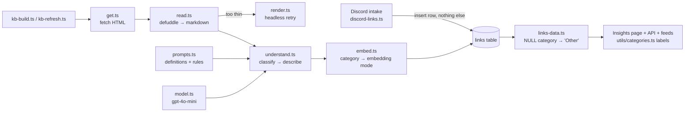

# Link categorization: what went wrong, why, and the fix plan

**Status: the reclassify has run.** `kb-build --stale` re-decided all
235 readable rows from stored markdown with prompt v6 (no refetches):
**234 understood · 97 category flips · 1,583 passages rebuilt · 2 errors,
both fixed** (see below). Live database vs golden set: **96.6% (56/58)**
— the bar. Two known misses remain: `ja.mt` (thin author-named homepage,
says article) and `whirrls.com` (the boundary the owner declined to rule).
The old 133k-words-unsearchable problem is gone: the remaining 79,734
unchunked words sit in place-type homepages (publications/people), which
are summary-mode by design.

## Reclassify results (2026-10-13)

Category movement, biggest first: 25 blog→article · 19 portfolio→people ·
8 blog→people · 6 gallery→inspiration · 5 newsletter→publication ·
5 blog→publication · 3 learning→article · 3 directory→inspiration ·
48 more in smaller groups (full table in the run log). New distribution:
tool 85 · article 74 · people 34 · learning 27 · publication 16 ·
directory 15 · inspiration 12 · other 2 · unreadable 3.

**Two live bugs the run exposed, both fixed:**
1. A prose block bigger than the chunk budget was never split, so
   `val.town` and `models.dev` produced a >8,192-token embedding input and
   the API rejected it. `chunk.ts` now windows oversized paragraphs
   (`windowProse`), verified live on both pages (13 and 197 passages).
2. Because `savePassages` embeds before it deletes, those two failures
   left OLD passages in place — stale summaries in search. Both rows were
   re-understood and re-embedded by hand (`promptVersion = null` then
   `--stale --only`), and the finished run has no rows with zero passages.

The 3 unreadable rows stay unclassified by design (JS/canvas pages with
no extractable text): `shapes.tools`, `michael.fm`, the Notion vault.

**Golden set:** 61 verdicts
including the bubbles/sidebar re-rulings. Prompt v5 written (identity
rule). Exam order flipped by owner-confirmed logic: **step-7 render
repairs run before the final exam** so the five unread pages score for
real. Awaiting go: v5 exam on deepseek-v4.1-flash + claude-haiku-5.5
(~$0.12). **No database rows rewritten yet.**

**Sources:** owner's manual review of the whole collection (2026-10, quoted in
section 2) · live database queries run 2026-10-13 · direct reads of the
pipeline code. Every number below comes from a query I ran, not memory.

---

## 1. The one-paragraph version

The classifier was given nine category definitions that mix two different
questions — *what is this page* vs *what place does it live in* — and no rule
for breaking the tie. A single post lives at `x.com/blog/post-title`, so it
matches both "article — one long-form piece" and "blog — an ongoing place of
writing". The model resolved the ambiguity by reading container words (the URL
path, the `<title>` suffix, the nav), i.e. the weakest possible signal. On top
of that: thin pages were classified with almost no evidence, failed reads
silently became "Other", the topic-vocabulary leash was never wired up, and
the whole collection was classified once with nothing to measure the run
against. The label error then cascades: a wrong label also sets the wrong
embedding mode, so **133,154 words of article text the database already holds
were never chunked or embedded** — search cannot see them at all.

---

## 2. The feedback, frozen

Owner's review, deduplicated (a few links were listed twice), grouped by where
each link should have gone. Owner notes in italics. `[`state`]` = what's in
the DB today, with the stored word count.

### 2.1 Should be **article** (24 links — all currently `blog` except one)

Owner on the whole set: every one of these is **clearly / obviously an
article** — single posts and essays, some from company blogs, none of them
blog index pages. The word "clearly" in the individual notes applies to all
of them.

| Link | Today | Owner note |
| :--- | :--- | :--- |
| blog.maximeheckel.com/posts/shades-of-halftone | blog · 5,991 w | clearly · *what made it cluster into Blog? what were the signs?* (§5.1) |
| thorstenball.com/blog/2026/09/19/what-i-believe-about-the-future-of-software-development | blog | clearly |
| ilanbigio.com/blog/lyft-bikes.html | blog | clearly |
| browserbase.com/blog/ai-browser-prompt-injection-containment-security | blog | clearly · *one-off post from a company blog, not a blog index page* |
| planetscale.com/blog/database-transactions | blog | clearly · company blog post, not a blog index |
| letta.com/blog/benchmarking-ai-agent-memory | blog | clearly · company blog post, not a blog index (listed twice) |
| joshcollinsworth.com/blog/easing-curves | blog | clearly |
| addyosmani.com/blog/loop-engineering | blog | clearly an article |
| seangoedecke.com/grit-your-teeth-and-ship-it | blog | clearly (listed twice) |
| hamvocke.com/blog/task-runners | blog | clearly |
| thinkingmachines.ai/blog/the-future-worth-building-is-human | blog | clearly |
| boristane.com/blog/slop-creep-enshittification-of-software | blog | clearly |
| anthonyhobday.com/blog/20260410 | blog · 5,693 w | clearly · *need to find why our system got it wrong* (§5.2) |
| ankursethi.com/blog/prevent-cognitive-debt-by-manually-retyping-llm-generated-code | blog | clearly |
| bellkiosk.website/blog/reasons-to-website.html | blog | clearly |
| blog.exe.dev/devtools-must-be-open-source | blog | clearly |
| dark.ronacher.eu/2026/7/21/never-enough | blog | clearly |
| humanlayer.dev/blog/writing-a-good-claude-md | blog | clearly |
| xlii.space/eng/i-hate-github-actions-with-passion | blog | clearly |
| buttondown.com/blog/how-we-migrated-our-database-to-planetscale | blog | clearly |
| smudge.ai/blog/ratelimit-algorithms | blog | clearly |
| atlas9.dev/blog/soft-delete.html | blog | clearly |
| brianlovin.com/writing/give-your-agent-a-laboratory | blog | clearly |
| yangshuntay.com/blog/work-on-the-right-product | blog | clearly |
| polymathinvestor.com/p/how-to-research-anything | **learning** · 3,631 w | clearly · a long essay; everything else in Learning is fine |

### 2.2 Should be **people** (today's `portfolio`, renamed — see §7)

| Link | Today | Owner note |
| :--- | :--- | :--- |
| udara.io | blog · thin · 151 w | a personal site, not a blog |
| ja.mt | blog | same |
| mamuso.dev | blog | same |
| stopa.io | blog | same |
| guzey.com | blog | same |
| paulstamatiou.com | blog | same |
| alexharri.com | blog | same |
| seangoedecke.com (homepage) | blog | mostly lists articles, but it is someone's personal site |
| maggieappleton.com/essays | article · 420 w | *I don't know how it even ended up in articles* (§5.3) |
| justinjackson.ca/articles | article · 2,038 w | *not sure how our system categorised it as article* (§5.3) |
| michael.fm | **null — read failed** | personal site |

### 2.3 Should be **learning**

| Link | Today | Owner note |
| :--- | :--- | :--- |
| lawsofsoftwareengineering.com | article · 968 w | |
| howqueryengineswork.com | article · thin · 136 w | *first page shows a small Acknowledgments section, the system read it as a one-off article; it didn't understand semantically* (§5.4) |
| makingsoftware.co | other · thin · 10 w | a niche indie course; the stored page is a **Vercel bot-checkpoint**, not the site (§5.4) |

### 2.4 Should be **tool** (one bucket — the product split was reverted, §7.4)

| Link | Today | Owner note |
| :--- | :--- | :--- |
| github.com/dmmulroy/better-result | article · 2,560 w | a library; *we need better categorisation between tools/libraries vs a SaaS product* — answered in §7.4: one bucket |
| shapes.tools | **null — read failed** | small niche tool |
| poolside.ai | blog · 229 w | tools or products or companies |
| midlife.engineering | blog · 656 w | *it's a company, a product* |

### 2.5 Should be **publications** (today's `blog`, renamed — see §7.1)

Currently scattered across `blog`/`article`: cold-takes.com,
bubbles.town, thecreativeindependent.com, are.na/editorial (owner: "if
`blog` was meant for links like these, the mother category should be
**Publications**"), plus:

| Link | Today | Owner note |
| :--- | :--- | :--- |
| pudding.cool | article · 458 w | *fits newsletter but is essentially a digital publication; not sure how to handle* (§7.1) |
| sidebar.io/domain/blog.jim-nielsen.com | blog | *might belong in newsletter* → Publications if newsletter folds in |

### 2.6 Should be **inspiration** (today's `gallery`, renamed — see §7.3)

| Link | Today |
| :--- | :--- |
| spottedinprod.com | directory |
| before.click | directory |
| detail.design | directory · thin |

### 2.7 Should be **directory**

| Link | Today |
| :--- | :--- |
| newincreative.notion.site/The-Vault-… (Nguyen's resource stash) | **null — read failed** |

### 2.8 Unsure

| Link | Today | Owner note |
| :--- | :--- | :--- |
| artificialanalysis.ai | article · 1,451 w | *AI benchmarks and indexes site; same topic family as deepswe.datacurve.ai; not sure which category* (§7.5) |

### 2.9 Notes on the categories themselves (owner's words, condensed)

- **Blog** is the most broken category — it got almost everything wrong, and
  it may be the wrong mother category entirely. What was *meant* to live
  there: cold-takes.com, bubbles.town, thecreativeindependent.com,
  are.na/editorial → that's **Publications**. Newsletters could fold in.
  Personal blog indexes (justinjackson.ca/articles, maggieappleton.com/essays)
  are not publications — they belong with **People**.
- **Galleries** — the name is fine but **Inspiration** fits better (even
  workspaces.xyz is "inspiration for workspaces"). Open problem: a topic
  called `inspiration` already exists, and a topic filter named
  "inspiration" inside a category named "Inspiration" would be weird UX
  (§7.3).
- **Portfolios** — not every personal site is a portfolio; some are personal
  blogs, gardens. "Personal sites" is two words; **People** is one. The
  system must reliably understand that blog *index* pages belong here, but
  must never pull a single post page into it.
- **Topics** — `pricing` showed up as a topic. *How can a label like
  "pricing" ever be a topic.* (Answer in §5.6.)

---

## 3. The components responsible

| File | Role in this bug |
| :--- | :--- |
| `src/lib/kb/categories.ts` | The labels, code-of-record. v1 had nine (the disputed `blog`/`portfolio`/`gallery` among them); v2 has eight after the tool/product merge (§7.4). |
| `src/lib/kb/prompts.ts` | `classifyPrompt` — the category definitions and the topic instruction. Contains the literal example "pricing" as a topic. `DESCRIBE_PROMPTS` — one instruction per category, so a wrong label also produces a wrongly-framed summary. |
| `src/lib/kb/understand.ts` | `sampleOf()` — classify sees only the first 1,500 words + ≤30 headings + word/link/image counts. `low` confidence → forced `other`. |
| `src/lib/kb/model.ts` | `CHAT_MODEL_ID = openai/gpt-4o-mini` — cheapest tier, doing a judgement call. |
| `src/lib/kb/store.ts` | `buildLink` orchestrator. `THIN_WORDS = 200` only *marks* a page thin — classify still runs on it. A failed read stores the intake description as the only passage and leaves `category` NULL. |
| `src/lib/kb/embed.ts` | `EMBEDDING_MODE`: article/tool/other → `full`; blog/learning/portfolio/gallery/directory/newsletter → `summary`. **The label decides how much of the page becomes searchable** — a wrong label is not cosmetic. |
| `scripts/kb-build.ts` | The runner. Accepts `knownTopics` nowhere — the topic leash exists in the prompt but is always empty. |
| `src/trigger/discord-links.ts` | Intake only inserts the row. It never runs the pipeline — a new link sits unclassified until the weekly refresh. |
| `src/trigger/kb-refresh.ts` | Weekly re-read, ordered by `extracted_at` ascending — and Postgres sorts NULLs last, so never-read rows are picked **last**, not first. |
| `src/app/insights/utils/links-data.ts` | Buckets any NULL/unknown category into `other` — failed reads masquerade as a classification. |
| `src/app/insights/utils/categories.ts` | Public labels ("Blogs", "Portfolios"…) — touched by any rename. |

Missing machinery: the spec (`docs/spec/insights-rebuild.md`) says "overrides
live in a data file and always win" — **no override file exists**. And no
golden set existed when the collection was classified, so the run was never
measured. (`eval/category-golden.json` was written after this review began;
it needs regeneration from §2 once §7 is decided — see §8 step 1.)

---

## 4. The database, measured today (2026-10-13)

**Category sizes (268 visible links):** tool 82 · article 53 · blog 44 ·
learning 26 · portfolio 23 · directory 16 · gallery 10 · newsletter 10 ·
other 1 · **null 3**.

**Read health:** ok 197 · thin 67 · failed 4.

**The expensive damage:**

| Symptom | Count | Consequence |
| :--- | ---: | :--- |
| summary-mode rows holding >800 words | **47** | **133,154 stored words never chunked/embedded — invisible to search** |
| NULL category | 3 | `shapes.tools`, `michael.fm`, the Notion vault — never classified; shown as "Other" |
| Bot-checkpoint classified anyway | 1 | `makingsoftware.co` — stored summary literally reads *"This page is a security checkpoint by Vercel"* |
| Topics | 643 distinct, **393 used exactly once** | the leash was never wired; `pricing` × 10, `tools` × 20, `coding` × 17, `resources` × 11, `blog` × 5, `inspiration` ×52 |
| Of 44 `blog` rows | 35 flagged wrong | 80% of the bucket — matches "most fucked up category" |

---

## 5. Root causes, each tied to code and evidence

### RC1 — The taxonomy mixes two axes, and the prompt never breaks the tie

`prompts.ts` defines *page-types* and *place-types* in one flat list:

- "article — **one long-form piece** of writing" (what a page IS)
- "blog — **an ongoing place** of writing (solo or magazine)" (what a place IS)

A post at `thorstenball.com/blog/2026/…` satisfies both. Nothing in the
prompt says a page is judged by what *it* is. That one missing sentence
explains ~24 of 35 blog errors. The same ambiguity covers `learning` vs
`article` (polymathinvestor's how-to essay), `gallery` vs `directory` (a
gallery whose items link out reads as "a list whose value is pointing
elsewhere"), and `portfolio` vs `blog` (a homepage that lists posts).

### RC2 — The signs the model actually used: container words

For every flagged post the model had weak-but-legible signals and took them:
the **URL path** (`/blog/`, `/posts/`, `/writing/`, date slugs), the **HTML
title suffix** ("Shades of Halftone - **The Blog of Maxime Heckel**"), and
nav text. Proof is in our own stored summaries — the describe call was
already handed the wrong label and baked it in:

- anthonyhobday → *"In the **blog** titled 'Notes on software quality'…"*
- maximeheckel → *"On the '**Blog** of Maxime Heckel,' the author dives deep…"*
- poolside.ai (a company homepage) → *"The site features a **blog** that dives into the research…"*

So mislabelling also **poisons summaries and therefore embeddings** — the
stored summary of an article describes it as a blog.

### RC3 — Index pages are structurally invisible to classify

`sampleOf()` passes counts ("N words · N links · N images") and a heading
outline, but the prompt never says what those numbers *mean*. A 420-word
essay index reads as intro prose, so:

- `maggieappleton.com/essays` → "article" — the model summarized the index
  as if it were one essay ("Maggie Appleton's essays explore…").
- `justinjackson.ca/articles` → "article" — even its own summary says "shares
  a **collection** of his diverse articles".
- `seangoedecke.com` → title is literally "All posts", still labelled blog.

### RC4 — Thin pages are classified with almost no evidence

`THIN_WORDS = 200` marks a row thin but **classify runs anyway**:

- `howqueryengineswork.com` — defuddle's first page is 136 words of
  Acknowledgements. Title stored: "Acknowledgements - How Query Engines
  Work". From that alone the model said "article" — confidently. It's a book.
- `udara.io` — 151 words → "blog".
- `makingsoftware.co` — 10 words of Vercel bot-checkpoint → classified
  (into `other` via low confidence), embedded, topics assigned, summary
  stored describing the checkpoint. Nothing detected "this is not a real
  page".

There is no evidence floor, no bot-wall detection, and no site-level
fallback (no sitemap/feed/second-page probe).

### RC5 — Failed reads leak into the UI as "Other"

A failed read leaves `category` NULL; `links-data.ts` buckets NULL →
"other". `shapes.tools`, `michael.fm`, and the Notion vault were **never
classified at all** — "Other" hides that. These three are pipeline bugs, not
judgement errors.

### RC6 — The model is the cheapest tier, and that is untested

`openai/gpt-4o-mini`. Some errors (RC1's ambiguity) no model can fix because
the definitions themselves are ambiguous; others (a 5,991-word interactive
shader tutorial labelled "blog") a stronger model would plausibly catch.
**Verdict deferred to the bake-off (§8 step 4) — prompt first, model
measured second.** Choosing a model without a scoreboard is the "random
fix and hope" pattern to avoid.

### RC7 — Topic pollution is self-inflicted, and the leash is dead code

Two separate failures:

1. `classifyPrompt` literally seeds the vocabulary:
   `"(short lowercase words: motion, typography, agents, pricing…)"` —
   that is where `pricing` (×10) came from. `tools`, `resources`, `coding`,
   `blog` as topics are the same class of pollution: category-shaped words
   wearing a topic hat.
2. The leash (`knownTopics` — "reuse these where they fit") exists in
   `prompts.ts` and `store.ts`, but `kb-build.ts` never passes anything.
   Every classification ran with an empty vocabulary → **643 distinct
   topics, 393 used exactly once.**

### RC8 — No ground truth, no measurement, no gate

The collection was classified once with nothing to score the run against.
No probe script exists; the only eval file was written after this review
began. With a full pass costing cents, measurement was always cheap — it
just wasn't built.

### RC9 — New links are never classified at intake

`discord-links.ts` inserts the row and stops. `kb-refresh` (weekly) orders
by `extracted_at` ascending, and Postgres sorts NULLs **last** — so a fresh
link waits behind every read row in the collection before its first
classification, and sits in "Other" meanwhile (via RC5's bucketing). The
spec says new links should walk the four verbs immediately; that was never
wired.

---

## 6. Answers to the questions embedded in the feedback

**5.1 What clustered posts into Blog? What were the signs?**
Container words: `/blog/` `/posts/` `/writing/` / dated URLs, and
`<title>` suffixes like "- The Blog of Maxime Heckel". The prompt's own
definition ("an ongoing place of writing (solo or magazine)") made those
signals decisive because it never says judge the page, not the container
(RC1/RC2).

**5.2 Why anthonyhobday.com/blog/20260410 specifically?**
Same shape: `/blog/` + numeric slug, 5,693 words of single-subject prose.
The stored summary even wraps it as "In the blog titled…" — the describe
step inherited the wrong label and fossilized it (RC2).

**5.3 How did index pages land in Articles?**
A short index reads as prose to a sample that starts at the first words;
the prompt gives the counts no meaning (RC3). Note both stored summaries
use collection language ("a collection of his diverse articles") — the
evidence was in the text, the prompt didn't ask the question.

**5.4 How to handle howqueryengineswork.com-type pages (semantically thin,
structurally a book/course)?**
Three layers, cheapest first: (a) an **evidence floor** — under N words of
real content, classify from URL + title + meta description only and force
low confidence → review queue instead of a confident wrong answer;
(b) **bot-wall detection** — Vercel/Cloudflare checkpoint patterns abort
classification and schedule a rendered re-read (this exact text is in
`makingsoftware.co`'s stored summary today); (c) a **site probe** for thin
pages — one request for `/sitemap.xml` or `/feed`: a sitemap full of
chapter-slug URLs is a book/course even when the cover page is 136 words.

**5.5 pudding.cool / sidebar.io / newsletters in general.**
Both dissolve if `blog` becomes **Publications** and newsletter folds in
(§7.1): pudding.cool is a digital publication; sidebar.io is a newsletter's
archive — a publication either way.

**5.6 Where does "pricing" the topic come from?**
From our own prompt — it's one of the four example topic words in
`classifyPrompt` (RC7). Not model whimsy.

**5.7 sujankhadgi.com: a clear portfolio marked "other" — why didn't the
OG metadata decide it?** It did reach classify — URL + title + OG
description are always passed — but a JS-heavy shell gives weak metadata
and a 130-word body, and under prompt v2's evidence floor the *honest*
answer is low-confidence → review queue, not a guess. That path worked as
designed; the repair is the rendered re-read in step 7, after which
classify sees the real page.

---

## 7. Taxonomy decisions (owner's call — everything below waits on this)

My recommendation in each row; the call is yours.

**7.1 `blog` → Publications; fold newsletter in.** ✅ recommended.
Defined as: an editorial outlet that publishes many pieces (magazines,
journals, curated letters). cold-takes, bubbles.town, thecreativeindependent,
are.na/editorial, pudding.cool, sidebar.io land here. Personal blog *index*
pages do **not** — they go to People. Single posts never land here at all.

**7.2 `portfolio` → People.** ✅ recommended.
A person's own site: bio, work, writing index, garden. Covers udara.io,
ja.mt, stopa.io, guzey.com, paulstamatiou.com, alexharri.com, mamuso.dev,
seangoedecke.com, michael.fm, maggieappleton.com/essays,
justinjackson.ca/articles. The classifier rule: an index/collection page of
one person's writing → People; one piece of their writing → article.

**7.3 `gallery` → Inspiration; the topic collision resolves itself.** ✅
recommended. Mechanism: add a write-time rule that **no topic may equal a
category name** (stop-list), so on the next pass the topic `inspiration`
disappears from the 20 links carrying it and gets replaced with real
subjects. The weird UI state (an "inspiration" filter inside "Inspiration")
can't exist if the topic can't exist. workspaces.xyz stays — inspiration
for workspaces is still inspiration.

**7.4 Tools vs products — decided: ONE `tool` bucket.** The first bake-off
proposed a `tool`/`product` split; the owner reverted it after reading the
mismatch list, and the data backs him: **v1's 82-row tool bucket had zero
flagged errors** — it was never broken — while the split instantly created
65 contested rows where the model drew a line the owner disputes
(`makeitanimated.dev`/`faster.dev` are courses, `mobbin.com` is
inspiration-with-a-paid-plan, `whirrls.com` is an illustration collection).
That is the blog/article disease — two labels on overlapping axes, no
decidable rule — recreated one category over. The fix: `tool` covers
**anything you use** (library, CLI, app, SaaS, company product, data
platform; free or paid), and the contested seams are carried by the
purpose rule instead: *what does the visitor come to do — look, learn, or
use?* A paid showcase is still inspiration; a paid course is still
learning. *Definition honesty: any SaaS "can be called a tool" — the point
of one bucket is that it doesn't have to decide.*

**7.5 artificialanalysis.ai, models.dev, deepswe.datacurve.ai** → **tool**.
Special-purpose data platforms you query; not writing, not a link list.
The boundary with directory: a directory's items only point elsewhere; a
database/registry's value is the data itself (models.dev ships a JSON API
of model specs).

**7.8 The identity rule (added after the v4 tournament).** A site named
after its author → **people**; a site with an editorial name of its own is
judged by mechanics: publishes original work or curates with commentary →
**publication**; aggregates other people's posts → **directory**. Resolves
cold-takes (publication), bubbles.town (directory) and the author-named
homepages (people) with one look at the name.

**7.6 A real `unclassified` state — internal, never a public filter.** ✅
agreed, with the owner's correction: an "unclassified" chip on the insights
page would feel weird. So: failed/unreadable rows get an explicit internal
state and surface in the owner's review queue (`kb-inspect` / a small admin
list) — and they simply **don't render on the public page** until
classified (they have nothing worth showing anyway: no markdown, no real
summary). Never the "Other" costume (RC5). `other` stays only for genuine
"confidently none of the above".

**7.7 The decisive rule, to be written at the top of the new prompt.**
*Judge the page, not the place it lives. One piece of writing is an
article even inside a blog, a company site or a publication. Place
categories (Publications, People, Inspiration, Directory) are only for
pages that collect or point to many things. Writing that teaches is still
an article; Learning is for structured teaching (course, book, curriculum)
including its landing page. A gallery that links out is still a gallery.*
And the purpose rule that carries every remaining seam: *what does the
visitor come to do — read one piece, follow an outlet, meet one person,
look, learn, use, leave via links?

---

## 8. The plan, ordered and cheap

**Step 0 — Decide §7.** Freezes the truth everything is scored against.

**Step 1 — Freeze ground truth.** Regenerate `eval/category-golden.json`
from §2 with the new taxonomy (it currently encodes pre-decision names and
points at a probe that doesn't exist). Add a holdout: the ~9 unflagged
`blog` rows (presumed-true publications) and a random sample of unflagged
rows, labelled with today's category — marked as lower-confidence truth,
since "not flagged" ≠ "verified".

**Step 2 — Build the probe harness** (`scripts/kb-classify-probe.ts`).
Classify-only: reads **stored markdown from the DB** (zero refetch, zero
writes), runs the real classify path (`classifyPage` in `understand.ts` —
what the probe measures is what ships) for every link in the collection,
prints old → predicted → expected and an agreement %. No describe, no
embed. Truth = golden corrections ∪ today's labels mapped v1→v2 for the
rest (the holdout, reviewed-but-not-flagged). Runs the **full 265-link
collection**: ~$0.10 mini · ~$0.20 flash · ~$0.70 haiku per run.
(Historical note: the first runs excluded a tool→product "boundary list"
as undecidable; the owner's review of that list killed the split outright
— §7.4 — so the caveat no longer exists.)

**Step 3 — Prompt v2, then measure.** Its contents, in order:
the decisive rule (§7.7); tie-break table (gallery>directory,
article>learning, People>Publications for personal places); index-page
detection using the link-count/heading stats it already receives; the thin
evidence floor + bot-wall recognition (§5.4); new taxonomy definitions;
topic stop-list (no category names; drop `tools/resources/coding/blog`);
example topics de-polluted; `knownTopics` actually wired into
`kb-build.ts`. Bump `PROMPT_VERSION`.

**Step 4 — Use a stronger model; still run the bake-off.** Owner's call:
repeated failed iterations cost more than tokens — a boring re-review is
the real expense. But the bar is *good enough*, not *strongest*: a full
268-link reclassify is ~1.6M input tokens, i.e. **~$0.40 on gpt-4o-mini,
~$1–3 on haiku/flash class, ~$5–9 on sonnet/gpt-5 class** — one-time.
Owner's constraint: **start the bake-off at the haiku/flash tier; touch
sonnet/gpt-5 only if the agreement bar isn't met.** Ongoing cost is intake
only (a few links a week), so any of these tiers is fine permanently — the
point is not to pay for headroom nobody uses.
Two provisos:
- **Split the pipeline model from the chat model.** `chatModel()` is
  shared with the live agent and the writing-desk (`agent.ts`,
  `writing-desk.ts`); the pipeline wants judgement quality, the agent
  wants latency + tool-calling cost. Add a `PIPELINE_MODEL_ID` in
  `model.ts`, leave `CHAT_MODEL_ID` alone.
- Run the bake-off anyway — it's one command and a dollar — starting from
  the strong tier. A stronger model does not fix ambiguous definitions
  (RC1), and occasionally follows structured instructions *worse*; the
  probe tells us in one run whether the upgrade actually moves agreement.
  Prompt v2 + strong model, not strong model *instead of* prompt v2.

**Step 5 — The bar.** ≥95% agreement on the feedback set, ≥90% on the
lower-confidence holdout. Below the bar: the taxonomy is still wrong, not
the model — back to §7. Above: proceed. This gate is the thing that makes
the next run trustworthy without a second full manual review.

**Step 6 — Reclassify the collection.** Classify + describe for all 268
visible rows (descriptions must be rewritten — current summaries carry the
wrong framing, RC2). Writes only `category / topics / summary /
embedding_mode / prompt_version / analyzed_at`. **Print the full
before → after diff for one eyeball** — the flagged 54 should flip as
the golden file says; anything else that flips is new information to
inspect, one pass only, not a re-review.

**Step 7 — Re-embed only what flipped.** Markdown is already on the row —
**no link is refetched**:
- `summary → full` (≈ the 47 damaged rows): chunk the stored markdown,
  embed. 133k words ≈ 180k tokens ≈ **< $0.01**.
- `full → summary`: delete the extra passages, keep the summary passage.
- Re-read the four broken rows (`shapes.tools`, `michael.fm`, Notion
  vault, `makingsoftware.co`) with the render fallback; if still
  unreadable → `unclassified` (§7.6), honestly shown.

### Results — the 2026-10-13 probe run (steps 1–4 done)

Prompt v2 + shared `classifyPage`; each model classified all 265 stored
markdown bodies. Cost: under $1 total for all three runs.

| Model | Golden (owner-verified) | Holdout (v1-label truth) | Boundary (tool→product) | Verdict |
| :--- | ---: | ---: | ---: | :--- |
| openai/gpt-4o-mini (v1 model) | 84.3% (43/51) | 90.2% (147/163) | 51 | fails the golden bar |
| anthropic/claude-haiku-4.5 | 88.2% (45/51) | 86.2% (137/159) | 55 | fails |
| **google/gemini-2.5-flash** | **96.1% (49/51)** | 85.9% (128/149) | 65 | **clears the ≥95% golden bar** |

Logs: `eval/probe-runs/*.log`.

**Flash's two golden misses, judged, not counted blindly:**
`makingsoftware.co` → `other`/low is the prompt working **as designed** —
the stored page is a Vercel bot-wall, so it honestly files for review and
flips only after the render re-read (step 7); scored strictly it's the
one artificial miss (49/50 = 98% without it). `sidebar.io/domain/…` →
`directory` is a ground-truth debate (it is literally a list of outbound
links), not a capability gap — call made, publication, recorded in §7.1.

**Holdout readings need a caveat.** Some "misses" are v1 truth being
wrong at v2 granularity, the model being *right*: `nautil.us` →
publication (it is a science magazine). These surface in the step-6 diff
for the owner's call, not in the bar.

**The owner's mismatch review (2026-10-13, frozen into the golden set):**
makeitanimated.dev & faster.dev → learning (courses are never tools) ·
mobbin.com → inspiration (paid plan irrelevant; its own title says "design
inspiration") · whirrls.com → inspiration · trails.pieterma.es/books →
directory (a person's book list; same precedent as the Notion vault) ·
models.dev → tool (special-purpose database) · sujankhadgi.com → people.
This review **killed the product split** (§7.4) and hardened the exam to
61 entries.

**The v3 rerun (merged tool bucket, prompt v3)** — flash:
**golden 87.9% (51/58)**, holdout 92.8% (192/207). The seven golden
misses: `mobbin.com`/`whirrls.com` → tool and `makeitanimated.dev` → tool
(the tool definition — "anything you use" — out-magnetized the purpose
rule; a course's one-page checkout read as "a thing to buy"), `ja.mt` →
article (thin personal homepage regressed), `models.dev` → directory
(data-vs-links line), `makingsoftware.co` → other/low (by design), and
`sidebar.io/…` → directory/high (the truth debate from §7.1 — the model
decided it *three times running*; it's in the golden file to keep the
debate visible, not to pretend it will flip).

**Prompt v4 (current)** targets those: tool is declared residual ("use it
only when the visit is to get or work with the thing itself — if the visit
is to look or to learn, those categories win, paid or not"); a course's
landing/sales page is learning; a short personal homepage is people; a
database/registry you query is a tool.

**v4 tournament (2026-10-13):**

| Model | Golden | Spend |
| :--- | ---: | ---: |
| claude-haiku-5.5 | 87.9% (51/58) | ~$0.08 |
| deepseek-v4.1-flash | 86.2% | ~$0.04 |
| gemini-3.8-flash | 86.2% (golden-only) | ~$1.00 — thinking-token burn; excluded |

(The first 2.5-flash attempt had already died mid-flight when the API key
hit its total limit; log: `eval/probe-runs/gemini-2.5-flash-v4.log`.)

Nobody cleared the bar — and the misses **converge identically across all
three models**: same 8 links, same wrong homes. Three models agreeing is
not capability failure; it's the truth file disagreeing with itself.
Rulings (owner, same day):
- `sujankhadgi.com`, `makingsoftware.co` → `other`/low everywhere: the
  thin-evidence path **working as designed**; they flip after the step-7
  rendered re-read.
- `cold-takes.com` → people (all three): the taxonomy contradicted itself
  (§7.2: single-author → people; §7.1 listed cold-takes as publication).
  Resolved by the new **identity rule (§7.8)** — outlet-named →
  publication, keeping the owner's verdict.
- `bubbles.town` → directory (all three): the models were *right* — the
  /about page ("community voting applied to thousands of personal,
  independent blogs") proves it an aggregator. **Owner re-ruled:
  directory.** His own principle, adopted: when place-type is ambiguous,
  feed the model site-level evidence (an /about or /feed hop) — plan
  step 5.5.
- `sidebar.io/domain/…` → directory: **owner accepted the unanimous
  verdict.** Golden updated.
- `whirrls.com` → kept `inspiration` (haiku-5.5 agreed; the only
  non-owner verdict in the file, flagged). `makeitanimated.dev` resisted
  `learning` across all three — the reclassify diff eyeball is the honest
  answer for it.

Prompt v5 adds the identity rule. The exam reruns **after the step-7
repairs** so the five unread pages score for real (owner-confirmed order
flip). New owner requirement, built: every probe run writes a **full
per-link JSON** (`eval/probe-runs/<model>-v<N>.json` — predicted category,
confidence, topics) so any run is reviewable end-to-end without rerunning.

**Golden vs holdout, one breath:** golden = the links the owner corrected
by hand — the exam. Holdout = everything else, graded with the old labels
as truth — the practice field, deliberately lower-trust.

**Two plumbing bugs the probe caught, fixed before any model comparison
was trusted:** (1) `generateObject`'s json-schema mode is rejected for
Anthropic models via OpenRouter → classify moved to
`generateText + Output.object` (`understand.ts`); (2) `topics: max(7)` in
the parse schema turned haiku's 9-topic answers into 152 whole-batch
errors → cap moved to write time. Lesson recorded: validate envelopes
permissively, enforce policy in application code.

**Decision (step 4):** `PIPELINE_MODEL_ID = google/gemini-2.5-flash` in
`model.ts`, wired into classify + describe; the chat/agent model is
untouched. Per the owner's cost constraint: haiku/flash tier, no
sonnet/gpt-5 needed — and the winner was decided by score, not tier.

**Step 8 — Code ripples of the rename.** `categories.ts`,
`utils/categories.ts` (labels), `InsightsList`, `rss.xml` route,
`llms-full.txt`, `/api/v1` filters + schemas, the suggestions script, the
MCP server; intake wiring (run `buildLink` on insert, or at minimum fix
the NULLS-last ordering in kb-refresh); the override data file the spec
promises. Update `docs/spec/insights-rebuild.md` in the same change —
spec and code must not disagree.

---

## 9. What runs against the DB, exactly

| Action | Rows | Columns / data touched | Refetches pages? | Est. cost |
| :--- | ---: | :--- | :--- | ---: |
| Re-read broken four (render fallback) | 4 | `markdown`, `word_count`, `content_hash`, `read_status`, `extracted_at` | yes, headless | $0 |
| Reclassify (classify + describe) | 268 | `category`, `topics`, `summary`, `embedding_mode`, `prompt_version`, `analyzed_at` | no | ~$0.40–2 |
| Re-embed summary→full flips | ~47 | `link_chunks` insert | no | < $0.01 |
| Re-embed full→summary flips | ~20 | `link_chunks` delete | no | < $0.01 |
| Topic cleanup | all | folded into the reclassify (stop-list enforced at write) | no | $0 |

Untouched: `markdown`, links, images, likes, embeddings of rows whose
category didn't flip. The embedding model itself is unchanged, so no
wholesale re-embedding.

---

## 10. Why the next run can be trusted

1. Ground truth frozen *before* the fix, not after.
2. Every prompt/model change scored by the probe — no unmeasured change
   ships.
3. The reclassify prints a complete diff; the review is one diff, not 269
   links again.
4. Failures get an honest internal `unclassified` state (review queue,
   not a public filter) instead of the "Other" costume.
5. `prompt_version` on every row: future taxonomy edits re-run only stale
   rows.
