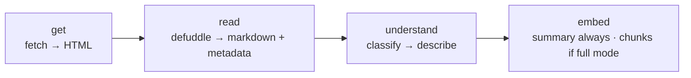

# Insights Rebuild — Spec

**Taxonomy v2 (2026-10-13):** the categories named below (`blog`, `portfolio`,
`gallery`, `newsletter`) are superseded — v2 is article, publication, people,
inspiration, tool, product, learning, directory, other, decided in
[`docs/review/categorization-feedback.md`](../review/categorization-feedback.md)
§7 and live in `src/lib/kb/categories.ts`. The mechanics below (four verbs,
stored markdown, embedding modes, reader, highlights) still stand; the
reclassify + rename ripples land per that doc's §8.

**Open, small:** rows that were never readable (a canvas app, a bot wall) simply stay
off the public collection — `scripts/kb-report.ts` is the review queue that lists them as
thin/failed. An in-app review surface is not built and is not needed while there are four.
The agent's answer quality is judged by hand through `scripts/kb-ask.ts`; an automated
answer-grounding check is still open (the chip pipeline has a substance check, answers
do not).

**Status:** the plan. Build order and proof gates: [`docs/plans/insights-rebuild.md`](../plans/insights-rebuild.md).
Renamed from `kb-v2.md` (scope outgrew the name: this covers the
pipeline **and** the reading/annotation surface). The v1 pipeline docs (`docs/kb/`) are gone with the pipeline they described — this
spec and `../review/categorization-feedback.md` are the record.

**How I want this built (2026-10 — read these before proposing anything):**

- One maintainer, no backwards compatibility. Anything can be deleted and rebuilt; there is
  no migration burden, only a rebuild run. **Links and their stored images (Vercel Blob)
  must survive. Like counts are disposable.**
- **Bought beats built.** Maintained libraries over custom code; custom stays only where no
  tool does the job, and small enough to hold in your head.
- **Every link is read and understood.** No channel gates, no skip lists.
- **The vectors hold everything the agent needs.** Fetches happen at build time, never at
  question time.
- **Nothing in the schema depends on Discord.** Discord stays one *intake* method (mobile
  convenience), not an identity provider. Own-on-site link drop comes later.
- **Plain names.** One stage = one file = one verb. Dead words: `note-only`, `read-shelf`,
  `SKIP_CHANNELS`, `kind` (→ `category`).
- **Tools get simpler, not fancier.** Drop a moving part the moment its job disappears.

---

## Keep — two levels, do not confuse them

| Level | Means | Applies to |
| :--- | :--- | :--- |
| **stored** | the page's markdown + metadata sit on the link's row | **every link, always** |
| **vectorized** | chunked + embedded as passages | only `full`-mode categories |

Reasons every link is *stored*: re-understanding never re-fetches; the reader (below) needs
the markdown pre-baked; storage is a text column, not a bill.

Reasons only some links are *vectorized*: a shelf's 1,200 items are a table of contents for
books we don't own; a course homepage is a cover, not the book; a portfolio's JS confetti is
not knowledge. **Every link still gets its model-written summary vectorized** — so every
link is answerable, chunked or not.

## The pipeline, four verbs



```
src/lib/kb/
  categories.ts  // the nine labels, one const (the code-of-record)
  get.ts         // getPage(url): HTML. One network seam, 5MB cap, browser UA
  render.ts      // renderPage(url): HTML. Headless; see "when rendering fires"
  read.ts        // readPage(html,url): { markdown, metadata }. The defuddle call
  understand.ts  // classify(url, sample, metadata) → describe(category, markdown, metadata)
  prompts.ts     // every word of prompt text, reviewable at a glance (PROMPT_VERSION)
  chunk.ts       // chunkMarkdown(md): units (headings = structure, fences = code units)
  embed.ts       // the category → embedding_mode map lives here; units → vectors
  store.ts       // every write + buildLink, the one orchestrator
scripts/kb-build.ts   // replaces kb-extract.ts; kb-refresh.ts calls the same buildLink
```

**When rendering fires:** defuddle's `wordCount` below threshold (~200) on the static pass →
render headless → re-read. JS-heavy sites (most portfolios) land here by construction — and
the owner's own homepage is the standing test case (Defuddle's static read drops homepage
sections; the rendered read keeps them). The rule stays this simple until rebuild data says
otherwise.

## understand — classify, then describe

Two model calls, two different jobs. The owner's observation, adopted: **one universal prompt
cannot do everything.**

1. **classify(url, metadata, bounded sample)** → `{ category, topics, confidence }`.
   Sample = first ~1,500 words + heading outline + link/image counts. Never a whole
   1,200-item shelf. Low confidence → `other` (the review queue).
2. **describe(category, markdown, metadata)** → `summary`, with one short instruction
   per category. All prompt text lives in one `prompts.ts` so it can be read and tweaked
   at a glance (nine micro-files would scatter the thing a person edits most). What each
   must squeeze from the single page:

   | category | summary must capture | vectorize |
   | :--- | :--- | :--- |
   | `article` | the thesis + key claims | **full** (all chunks) |
   | `tool` | what it does, who it's for, pricing/free tier, open-source? | **full** (landing text powers compare questions) |
   | `learning` | what it teaches, structure/TOC if present, FAQ nuggets, price if shown; honestly thin if the page is thin | summary |
   | `portfolio` | who the person is, what they do, notable work, socials | summary |
   | `blog` / `gallery` / `directory` | what the place is, what kind of things it collects, what you'd get from browsing it | summary |
   | `newsletter` | what it covers, how often it comes out, who writes it | summary |
   | `other` | whatever the page gives | **full** |

**The one rule every prompt in this stage follows:** the page's own voice wins. Summaries
keep the site's tone and phrasing — quote a line when it's good, never flatten it into
bland AI-speak. And nothing enters a summary that isn't on the page: no guessed pricing,
no inferred topics, no "this site could help you…". **If it's not on the page, it's not
in the summary.**

`tool = full` is the only debatable row: it exists because "which sandbox for long-running
agents, what's cheapest" (the original spec's pain #2) needs landing text, not a blurb. The
map is one lookup — flip it if compare answers stop needing it.

## Categories, public

`kind` is renamed **`category`**. Categories are **public-facing filters** on the insights
page (chips / filter param) — not just pipeline metadata. Grouping follows too: the page
arranges by `category`; `channel` stays only as a raw note about where a link came from.

## Schema: Discord out, link-key in

- **Identity is `url_key`.** `discord_id` demotes to a nullable note (`source` stays; coming
  from Discord is a fact about how the link arrived, not a key anything needs).
- **Likes re-key to the link, not the snowflake** — or are dropped if simpler. Counts are
  disposable; rows and Blob images are not.
- Future own intake (drop a link on the site) becomes possible *because* nothing keys on
  Discord. Recorded as later, not now.

## Why markdown lives in the database

The alternatives, and why each loses:

| Way | Why it loses |
| :--- | :--- |
| re-fetch the page when needed | slow at reader/question time, and pages rot — the health sweep already watches links die. The collection would decay with the web. |
| store the raw HTML | 10–50× the bulk, mostly junk; the extraction cost gets paid again on every read |
| store plain text | v1's flaw: no links, no headings, no code fences — and the reader would have nothing to render |
| store cleaned HTML | bulkier than markdown, worse to chunk, and we'd convert to markdown anyway |
| store markdown in Blob/files | a second store to keep in sync for ~269 text rows; the whole collection is tens of MB, which Postgres eats without noticing |

Markdown sits on the row, next to its metadata: LLM-ready, renders the reader, chunks with
structure, and one `content_hash` tells the refresh when a page changed.

## Reader mode (articles only)

`/insights` grows an inline reader for `category = article`:

- **Renders the stored markdown** — always pre-baked, zero request-time fetches, zero cost
  per open. Design bar: seamless, distraction-free, typographically serious.
- **Highlights.** Selecting text highlights it (component reference:
  `github.com/SanyamPunia/www` → `components/labs/highlight-wave`). Highlights persist in a
  `highlights` table (`link_id`, quoted text, anchor offsets/prefix-suffix, `created_at`).
  **Only the owner writes; everyone reads** — highlights are visible to any visitor.
  Fetchable via API (collected highlights are a personal export).
- **Highlights feed retrieval (phase 2).** Highlighted spans are the strongest relevance
  signal the collection has; passages containing them get boosted. Revive once ~50 exist —
  before that the signal is noise. The payoff is incremental by design.
- **Per-article ask composer** at the bottom: questions scoped to that article's passages
  (`search` gains a `link_id` scope — one filter, already-indexed data).
- The reader doubles as a **maintenance layer**: reading and highlighting in-place is how
  the collection gets curated over time. That is the point.

## What dies

`extract.ts` (ladder + Readability + github/stripMarkdown special cases) · `SKIP_CHANNELS` ·
`splitLongParagraph` · the `skipped` status · the `/pricing` second hop (single page only,
always — compare prompts make do; revive only if compare answers prove the gap) ·
per-channel strategy in `insights-agent.md` · `kind` as a word.

## Things nobody said out loud

- **New links walk the same road.** Discord intake writes the row; the four verbs run for
  that one link right away, not at the next rebuild. A repost of an existing `url_key` is
  a skip.
- **Pages change under a stable URL.** A tool pivots; a shelf becomes a blog. Rule: when
  the refresh sees the markdown change, understand re-runs; if `category` or
  `embedding_mode` flipped, that link's passages are rebuilt. A category describes the page as it is now,
  not as it was saved.
- **Dead links become the archive's best trick.** `dead` stops re-reading, but the stored
  markdown keeps the article alive in the reader forever. Storage turns rot from a loss
  into a shrug.
- **Topics need a leash.** Free-form keywords drift into synonyms (motion / animation /
  animations). Cheap control: describe receives the topics already in use and prefers
  them; new coinages allowed, rare. One line in the prompt, one query to build the vocab.
- **The `other` pile has an owner.** Built 2026-10-14: overrides live in
  `src/content/category-overrides.json` and always win at write time (the probe ignores
  the file, because it measures the model). Fixing one link = edit the file, then
  `kb-build --stale --only <urlKey>`. The world is never re-classified to fix a handful.
  **Next step, when the list grows past a handful:** an admin page that edits the same
  correction against the row, so it stops being a file and a command.
- **Highlights must survive re-reads.** Anchor = quote + prefix/suffix + occurrence
  index. If a refresh breaks the anchor, the highlight hides (marked stale) — never
  silently deleted.
- **The reader is a view, not a route.** Articles open as a side panel inside
  `/insights` (list on the left, panel slides in; Back/Escape/outside-click closes).
  Markdown ships via `GET /api/insights/article`, rendered with react-markdown + shiki
  (MDX executes JavaScript — wrong tool for untrusted pages). Stored markdown is
  **untrusted content**: sanitized, no raw HTML.
- **Hidden stays hidden.** Hide/unhide work as today; hidden rows never enter build or
  search — same join filter as v1.
- **Ripples of channel → category.** Suggestion chips quota by channel; RSS and llms.txt
  group by it; the agent's search tool takes `channel=`; cards show the intake blurb.
  They all move to `category` — and cards can now show the **summary**, instantly better
  than a five-year-old og description. A pass touches: suggestions script, rss/llms
  routes, agent tool schema, `/api/v1` filters, `InsightsList`.
- **The build pays once.** ~269 defuddle reads (free), ~269 understand calls (≈2k tokens
  each, cents), embeddings for summaries + full-mode chunks (cents). The rebuild lands
  **under a dollar** — followed by a `kb-eval` smoke run to prove retrieval still
  breathes.

## Open, decided by building it

1. **Does anything still need the headless browser once defuddle runs?** Rebuild
   statically, count the links that come back too thin to use: near zero → delete
   `render.ts`; a real pile → keep it as the fallback.
2. `fetch_link`'s future — narrows to outside-URL compares; decide from question logs.
3. Minimal rot check when a link is embedded (passage cap per link, duplicate-text
   share).
4. **The reader puts other people's articles on your domain — needs your yes.** v1 only
   *stored* text privately; the reader would publish full articles publicly. Mitigations
   ready: a prominent source link + author on every reader page, and `noindex` on the
   route. Worth a real decision, not a footnote.

## Details, so nobody guesses

### The `links` row, v2

| column | type | note |
| :--- | :--- | :--- |
| `url_key` | text, unique | the identity |
| `url` | text | |
| `title` | text | backfilled from defuddle on read |
| `description` | text | intake text; defuddle's description joins on first read |
| `source` | text, default `discord` | how the link arrived |
| `channel` | text, nullable | raw intake note; nothing groups by it |
| `markdown` | text | defuddle content |
| `word_count` | int | from defuddle |
| `category` | text, indexed | one of the nine |
| `topics` | text[] | |
| `summary` | text | model-written, in the page's own voice |
| `embedding_mode` | text | `full` \| `summary` — how much of the page lives in vectors |
| `read_status` | text | `pending` \| `ok` \| `thin` \| `failed` (renamed from `extract_status`) |
| `content_hash` | text | hash of the markdown; refresh re-embeds only on change |
| `prompt_version` | smallint | which prompt set + model produced category, topics, summary |
| `analyzed_at` | timestamptz | when that last ran |
| `hidden_at`, health fields, `added_at`, `created_at`, `updated_at` | as today | |

`discord_id` stays as a nullable note; nothing queries by it. Likes re-key to the link or
drop.

### `link_chunks`, v2

Same as v1, plus:

- `unit_type` text — `summary` \| `prose` \| `code`; summary passages are first class,
  code chunks filterable/de-prioritizable.
- `heading` text, nullable — the section the chunk came from (`## Exit animations › Why
  exits feel wrong`), so a passage is never anonymous.

### `highlights`

| column | type | note |
| :--- | :--- | :--- |
| `id` | identity pk | |
| `link_id` | fk → links, cascade | |
| `quote` | text | the highlighted words |
| `prefix` / `suffix` | text | anchoring context, so a highlight re-finds its spot after a re-read |
| `occurrence` | smallint | which match of `quote` it was (quotes repeat) |
| `stale` | boolean, default false | anchor lost on re-read → hidden, never deleted |
| `created_at` | timestamptz | |

Index on `link_id`. Writes: admin only. Reads: public.

### Query rules (performance)

- **No list query ever selects `markdown`** — megabyte rows never ride a list page. The
  column loads only on the reader route, one row, by indexed `url_key`.
- Reader pages revalidate **on write** (rebuild, refresh, new highlight), never per visit —
  a 10k-word article is ~100KB, one query.
- Insights list stays cursor-paginated as today; the `category` filter uses its index.
- Search keeps today's top-k; the per-article composer just passes a `link_id` scope.
- Highlights per article: one small join.

### The embedding-mode map (lives in `embed.ts`)

```ts
const EMBEDDING_MODE: Record<Category, "full" | "summary"> = {
  article: "full",
  tool: "full",
  other: "full",
  learning: "summary",
  portfolio: "summary",
  blog: "summary",
  gallery: "summary",
  directory: "summary",
  newsletter: "summary",
};
```

### Migration, one run

- Rename `raw_text` → `markdown`, `extract_status` → `read_status`.
- Add `category`, `topics`, `summary`, `embedding_mode`, `word_count`, `prompt_version`,
  `analyzed_at`; `link_chunks.unit_type` + `heading`; the `highlights` table; an index
  on `category`.
- Truncate `link_chunks`, reset every row to `pending`, rebuild the collection through the
  new pipeline once.

## The message behind this spec (kept word for word)

<details>
<summary>2026-10-10 · keep levels, Discord out, reader mode + highlights</summary>

Wait, see, almost everything in the docs is fine and agreeable but there are couple of things I would want to point out.

You said learning, tool, portfolio - all such site's extracted markdown will be kept? Bdw, be keep, I don't understand where to keep exactly.. So let me know if there's any misunderstanding.

Let me tell you some of my doubts or questions or maybe something I misunderstood. There's also another feature that just hit me which I'll ellaborate below that will actually be better to make the RAG better indirectly. By indirectly I mean the feature does 2 things at once. I've ellaborated this in Topic C.

Topic A: (Regarding what to keep)
- portfolios: these kind of sites are JS heavy, for example imagine I have site like mine, first of all, it might be tough to correctly extract such JS heavy sites to clean data that will be useful for the agent, but even if we solve this with say Defuddle or something else, there's no value in keeping all of those extracted metadata.. and later also have in vector.. we just need understand who's portfolio is this, who's the guy behind it, what does he do, socials maybe or something other worth keeping. This is why I told you we need a sematic understanding of the site but yeah for understanding it sematically, we prolly to extract the markdown so it can be fed to an llm? so maybe that's what you mean by keep? Also, another note, I tried my sites url: souravinsights.com with Defuddle web app, it left a lot of the sections contents that's in my home page, whereas Firecrawl and even Microlink's url to markdown gave me decent output. So maybe that's why you mentions this line: "then render in a headless browser and re-read the rendered HTML" in the "get" util?? But the rules/system that detects which sites/pages definitely need this step, should be good enough..

- learning: again for such sites, let's imagine a site like: https://handbook.modular.com/ now, if we just scrape/extract this using Defuddle, it will just give us whatever there's in the hompe page which is of no value, and we can't just scrape or look for all the other pages since setting up a generic rule for such usecases might break something else.. so maybe just keep the metadata content here? if there's actually a simpler and better way than this then it's fine otherwise it should fallback to the metadata only.. Also, I have some other indie well made courses like: https://devouringdetails.com/ that aren't free, some of the have faqs so I think it's important to record such info? But obviously, no scraper can do this.. I think we can just extract whatever the single page gave us, feed to an llm with a proper prompt that can do that for us.. This also gives me an idea that we may need various kinds of system prompts for various kinds of sites/page. One universal system prompt can't do everything.. That's just a rough observation.

Topic B: (Regarding the rows/columns for discord related data)

First of all, the term kind, basically means categories right? So maybe it can be renamed to category? If we are going to derive categories, won' it actually make sense to have them as public facing filters? Yes, it will. And somehow, the schema needs to evolve in a way that we can drop any dependecies related to Discord data, be it id or something else. Note, I'll still use Discord channels to drop my links, just because it's easier with my mobile app but it should be used to fetch the links. Our AI system will anyway, categorize it moving forward. Maybe, we can also get rid of Discord entirely and have a way to drop my links in my site itself.. But that's for later. But our schema needs to evolve. Nothing should depend on Discord data, especially the likes. There's not a big problem if some schema changes drops the likes count, but yeah, links themselves shouldn't be lost, and also the images of each links that are in the Vercel blog.

Topic C: (The new idea that I mentioned above which indirectly improves our RAG and the whole system)

Since we have found that Defuddle can give us markdown contents, why not have an inline "reader" within my insights page itself that can render the markdown to a styled page? We can definitely have a reader mode. But yeah note that a reading mode only makes sense for article sites. We won't have a reading mode for anything else. By having a reader mode has few crucial benifits:

1. I can highlight my fav lines, insights, prose or anything in the site. Those highlights should be permanently be stored in a db so that anyone who opens the article in the reader mode, they can see the highlighted text. Highlighting is a kind of feature that's very essential for me since I read a lot and what's better than collecting the highlights in my own site and being able to extract the highlights via my own api.
2. Having highlights can also feed back into our RAG/agent, those highlighted sections can be used as good signals. But yeah, it will take time for me to highlight and it will be an ongoing process which will pay off incremenatlly not in a day.
3. Being able to read within my site and highlight will also encourage me ton spend more time on the articles that I add to my collection which will also act as a maintainace layer.
4. Having a reader mode can also have another advantage, which is to have a tiny "ask composer" at the bottom that me and people can use to ask questions related to that specific article whihc is another cool feature.

But this reader mode design has toseamless, well designed, distraction free and well implemented as well. Having a reader mode means that we will somehow have to store the extracted markdown of the articles somewhere so that we don't have to call the api or so something on the fly, it should be always there, not at request time, to save money. For the highlights feature, we can use this component: https://github.com/SanyamPunia/www/tree/main/components/labs/highlight-wave

That's allll.. I know it's too long so please read everything carefully, read everything that I wrote twice or thrice if necessary so that you do not miss anything that's mentioned here.. Once done, you should update the relevant spec doc accordingly, maybe, we should also rename the current spec: kb-v2.md to something better that suits our new scope

</details>
