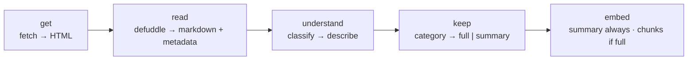

# Insights Rebuild — Spec

**Status:** the plan. Renamed from `kb-v2.md` (scope outgrew the name: this covers the
pipeline **and** the reading/annotation surface). Everything in `docs/kb/` +
`docs/spec/insights-agent.md` still describes the v1 build that runs today, until the
rebuild below replaces it.

**Directives (2026-10, the owner, verbatim intent — read before proposing anything):**

- One maintainer, no backwards compatibility. Anything can be deleted and rebuilt; there is
  no migration burden, only a rebuild run. **Links and their stored images (Vercel Blob)
  must survive. Like counts are disposable.**
- **Bought beats built.** Maintained libraries over custom code; custom stays only where no
  tool does the job, and small enough to hold in your head.
- **Every link is read and understood.** No channel gates, no skip lists.
- **The vectors hold everything the agent needs.** Fetches happen at build time, never at
  question time.
- **Nothing in the schema depends on Discord.** Discord stays one *intake* method (mobile
  convenience), not an identity provider. Own-on-site link drop comes later.
- **Plain names.** One stage = one file = one verb. Dead words: `note-only`, `read-shelf`,
  `SKIP_CHANNELS`, `kind` (→ `category`).
- **Tools get simpler, not fancier.** Drop a moving part the moment its job disappears.

---

## Keep — two levels, do not confuse them

| Level | Means | Applies to |
| :--- | :--- | :--- |
| **stored** | the page's markdown + metadata sit on the link's row | **every link, always** |
| **vectorized** | chunked + embedded as passages | only `full`-mode categories |

Reasons every link is *stored*: re-understanding never re-fetches; the reader (below) needs
the markdown pre-baked; storage is a text column, not a bill.

Reasons only some links are *vectorized*: a shelf's 1,200 items are a table of contents for
books we don't own; a course homepage is a cover, not the book; a portfolio's JS confetti is
not knowledge. **Every link still gets its model-written summary vectorized** — so every
link is answerable, chunked or not.

## The pipeline, five verbs



```
src/lib/kb/
  get.ts         // getPage(url): HTML. One SSRF-guarded seam, 5MB cap, browser UA
  render.ts      // renderPage(url): HTML. Headless; see "when rendering fires"
  read.ts        // readPage(html,url): { markdown, metadata }. The defuddle call
  understand.ts  // classify(url, sample, metadata) → describe(category, markdown, metadata)
  keep.ts        // one lookup: category → "full" | "summary"
  chunk.ts       // chunkMarkdown(md): units (headings = structure, fences = code units)
  embed.ts · store.ts · search.ts · agent.ts
scripts/kb-build.ts   // replaces kb-extract.ts + kb-refresh.ts
```

**When rendering fires:** defuddle's `wordCount` below threshold (~200) on the static pass →
render headless → re-read. JS-heavy sites (most portfolios) land here by construction — and
the owner's own homepage is the standing test case (Defuddle's static read drops homepage
sections; the rendered read keeps them). The rule stays this simple until rebuild data says
otherwise.

## understand — classify, then describe

Two model calls, two different jobs. The owner's observation, adopted: **one universal prompt
cannot do everything.**

1. **classify(url, metadata, bounded sample)** → `{ category, topics, confidence }`.
   Sample = first ~1,500 words + heading outline + link/image counts. Never a whole
   1,200-item shelf. Low confidence → `other` (the review queue).
2. **describe(category, markdown, metadata)** → `summary`, with **one prompt per category**,
   each tiny and in its own file. What each must squeeze from the single page:

   | category | summary must capture | vectorize |
   | :--- | :--- | :--- |
   | `article` | the thesis + key claims | **full** (all chunks) |
   | `tool` | what it does, who it's for, pricing/free tier, open-source? | **full** (landing text powers compare questions) |
   | `learning` | what it teaches, structure/TOC if present, FAQ nuggets, price if shown; honestly thin if the page is thin | summary |
   | `portfolio` | who the person is, what they do, notable work, socials | summary |
   | `blog` / `gallery` / `directory` | what the place is, its flavor, what browsing it yields | summary |
   | `newsletter` | what it covers, cadence, who writes it | summary |
   | `other` | whatever the page gives | **full** |

`tool = full` is the only debatable row: it exists because "which sandbox for long-running
agents, what's cheapest" (the original spec's pain #2) needs landing text, not a blurb. The
map is one lookup — flip it if compare answers stop needing it.

## Categories, public

`kind` is renamed **`category`**. Categories are **public-facing filters** on the insights
page (chips / filter param) — not just pipeline metadata.

## Schema: Discord out, link-key in

- **Identity is `url_key`.** `discord_id` demotes to nullable provenance (`source` stays;
  a row from Discord is a fact about intake, not a key anything needs).
- **Likes re-key to the link, not the snowflake** — or are dropped if simpler. Counts are
  disposable; rows and Blob images are not.
- Future own intake (drop a link on the site) becomes possible *because* nothing keys on
  Discord. Recorded as later, not now.

## Reader mode (articles only)

`/insights` grows an inline reader for `category = article`:

- **Renders the stored markdown** — always pre-baked, zero request-time fetches, zero cost
  per open. Design bar: seamless, distraction-free, typographically serious.
- **Highlights.** Selecting text highlights it (component reference:
  `github.com/SanyamPunia/www` → `components/labs/highlight-wave`). Highlights persist in a
  `highlights` table (`link_id`, quoted text, anchor offsets/prefix-suffix, `created_at`).
  **Only the owner writes; everyone reads** — highlights are visible to any visitor.
  Fetchable via API (collected highlights are a personal export).
- **Highlights feed retrieval (phase 2).** Highlighted spans are the strongest relevance
  signal the collection has; passages containing them get boosted. Revive once ~50 exist —
  before that the signal is noise. The payoff is incremental by design.
- **Per-article ask composer** at the bottom: questions scoped to that article's passages
  (`search` gains a `link_id` scope — one filter, already-indexed data).
- The reader doubles as a **maintenance layer**: reading and highlighting in-place is how
  the collection gets curated over time. That is the point.

## What dies

`extract.ts` (ladder + Readability + github/stripMarkdown special cases) · `SKIP_CHANNELS` ·
`splitLongParagraph` · the `skipped` status · the `/pricing` second hop (single page only,
always — compare prompts make do; revive only if compare answers prove the gap) ·
per-channel strategy in `insights-agent.md` · `kind` as a word.

## Open, decided by building it

1. Render residual size after defuddle (delete `render.ts` if ~0).
2. `fetch_link`'s future — narrows to outside-URL compares; decide from question logs.
3. Minimal rot gate at keep-time (passage cap per link + duplicate-text share).
