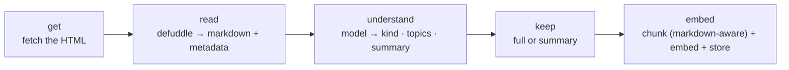

# KB v2 — the pipeline, rebuilt simple

**Status:** the plan. Supersedes `classification.md` and `markdown-extraction.md` (deleted;
their content is folded in here). Everything in `docs/kb/` + `docs/spec/insights-agent.md`
describes the v1 build that still runs, until the rebuild below replaces it.

**Directives (2026-10, the owner, verbatim intent — read before proposing anything):**

- One maintainer, no users of the internals, **no backwards compatibility**. Anything can be
  deleted and rebuilt; there is no migration burden, only a rebuild run.
- **Bought beats built.** A maintained library replaces custom code wherever one exists.
  Custom code survives only where no tool does the job — and stays small enough to hold in
  your head.
- **Every link is read.** No channel gates, no skip lists, no "this kind of link we never
  fetch." Kind decides *what we keep*, never *whether we look*.
- **The vectors hold everything the agent needs.** Fetches happen at build time, not at
  question time.
- **Every link is understood.** Each link gets a model-written summary, kind and topics —
  even links whose content we don't chunk. There is no invisible corner of the collection.
- **Plain names.** One stage = one file = one verb. No cleverness, no legacy terms
  (`note-only`, `read-shelf`, `SKIP_CHANNELS` are dead words). A new agent reads the tree
  top to bottom and knows what runs where.
- Delete freely: today's chunks, statuses, and extractors are v1 debris, not constraints.

---

## The pipeline, five verbs



One file per verb, named after it:

```
src/lib/kb/
  get.ts         // getPage(url): HTML. The one network seam (SSRF-guarded, 5MB cap)
  read.ts        // readPage(html, url): { markdown, metadata }. The defuddle call
  understand.ts  // understandLink(url, markdown, metadata): { kind, topics, summary }
  keep.ts        // decideKeep(kind): "full" | "summary"   (the kind→keep map, one lookup)
  chunk.ts       // chunkMarkdown(markdown): units. Headings = structure, fences = code units
  embed.ts       // unchanged concept
  store.ts       // writes links row + passages (replaces ingest.ts)
scripts/
  kb-build.ts    // the pipeline over rows (replaces kb-extract.ts / kb-refresh.ts)
```

## get

Plain fetch, browser UA, 10s, ≤5 redirects, 5MB cap. ~60 lines, kept because defuddle's node
entry takes a Document and exposes no fetcher — and we need the seam for the SSRF guard.

**JS rendering:** static first for every link. If defuddle comes back near-empty
(`wordCount` below threshold), *then* render in a headless browser and re-read the rendered
HTML. The v1 render code (`render.ts`) survives only for this measured residual — keep it
if the rebuild shows a real JS-only set, delete it if the set is ~0. Decision by data, not
precaution.

## read

`Defuddle(document, url, { markdown: true, useAsync: true, fetch: guardedFetch })` →
`content` (markdown) + metadata (`title`, `description`, `author`, `published`, `site`,
`image`, `language`, `wordCount`, `schemaOrgData`). Pinned exact (`0.19.5`).

What this deletes from v1: Readability, `clean()`, the GitHub README special case +
`stripMarkdown`, hand meta parsing, manual word counting, the `Untitled` backfill, and
`SKIP_CHANNELS` itself — there are no skipped channels anymore. Portfolios and newsletters
are fetched and read like everything else.

Consumption paths and their verdicts are recorded in git history (the rejected hosted
defuddle.md API, the CLI for eyeballing).

## understand

One model call per link. Input: defuddle metadata + **a bounded sample** of the markdown —
first ~1,500 words + the heading outline + link/item counts. Long pages are sampled, never
fed whole (a 1,200-entry directory does not get 1,200 entries into the prompt).

Output (fixed shape): `{ kind, topics[3–7], summary, confidence }`.

- `kind` — one label (below).
- `topics` — free-form keywords.
- `summary` — two sentences, model's own words. **Always stored, always embedded.** This is
  the semantic layer: blogroll.org becomes answerable without keeping its 1,200 items.
- Low confidence → `other`, the review queue.

### Kinds

| kind | what it is | keep |
| :--- | :--- | :--- |
| `article` | one long-form piece | **full** |
| `learning` | a course, book, tutorial site | **full** |
| `tool` | a thing you use — app, SaaS, library | **full** |
| `portfolio` | a person or studio's own site | **full** |
| `blog` | an ongoing place of writing | **summary** |
| `gallery` | a site to look at for inspiration | **summary** |
| `directory` | a list whose value is pointing elsewhere | **summary** |
| `newsletter` | a subscription page | **summary** |
| `other` | fallback + review queue | **full** |

The map is one lookup in `keep.ts`, overridable per link. `summary`-mode links store only
their summary; `full`-mode links store summary **and** their chunked content.

## keep

Two storage modes, two words: `full` | `summary`. Replaces v1's treatments
(`read`/`listed`/`noted`) and every special case around them. Question each link answers:
*"is your content the knowledge, or is the knowledge elsewhere?"* Shelves and signposts
(blog, gallery, directory) get understood and summarized; their 1,200 items are a table of
contents for books we don't own.

## embed

- Chunk **markdown**, not plain text: split on headings/paragraphs, ~500 tokens, 15% overlap.
  Fenced code blocks are their own unit kind, tagged so they can be filtered or
  de-prioritized. (v1's newline-destroying `splitLongParagraph` dies with plain text.)
- Embedded text keeps the `{title} — {channel}:` header; `content` stays clean markdown.
- **The old passages are discarded.** `link_chunks` is truncated and the collection rebuilt
  through this pipeline once (269 links).

## Storage

`links` grows/reorganizes (no backwards-compat constraints):

| column | note |
| :--- | :--- |
| `markdown` | defuddle content (renamed from `raw_text`) |
| `kind` | from understand |
| `topics` | text[] |
| `summary` | model-written; embedded as the link's first passage |
| `word_count` | from defuddle |
| `keep` | `full` \| `summary` |
| `extract_status` → `read_status` | `pending/ok/thin/failed`, v1 name cleaned up |
| `classifier_version` + `classified_at` | understand's model + prompt version |

## What dies in v1 code

`extract.ts` (ladder + Readability + github/stripMarkdown + readPricing) · `SKIP_CHANNELS` ·
`splitLongParagraph` · the `skipped` status · `note-only`/`read-shelf`/`read-page` terms ·
per-channel strategy table in `insights-agent.md`. The channels themselves stay — as display
grouping, never as pipeline logic.

## Open, decided by building it

1. **render.ts keep-or-delete** — after the rebuild, count links that still read thin
   statically. Near zero → delete; real set → keep as the residual fallback.
2. **`fetch_link`'s future** — with vectors holding everything, the tool narrows to
   *comparing outside URLs* (its original SSRF-guarded job). Keep it for that, or drop it.
   Decide after the rebuild by looking at actual question logs.
3. **Quality gate for rot** — v1 saw a page decay into a spam farm. One small check at
   keep-time (passage cap per link, duplicate-text share) re-earns its place; no more.
