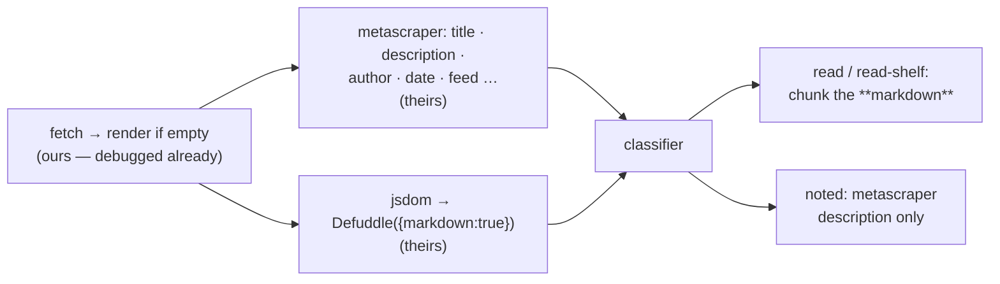

# Markdown Extraction — Spec

**Status:** agreed direction. Gate before wiring: the fixture bake-off at the bottom.

Store pages as **markdown**, not scraped plain text. Markdown is the LLM-ready format: link
targets, headings and code fences survive, which plain text destroys. The classifier, the
chunker and the `read-shelf` treatment all get strictly better input.

Companion spec: [`classification.md`](./classification.md) (what a link *is*; this doc is how
we *read* it).

---

## Why now — recorded failures of the current reader

Measured in `docs/review/system-review.md`, not taste:

- Readability's `textContent` **erases link targets** — a shelf page becomes dead text where
  items, signposts and prose are indistinguishable. The listed treatment cannot work on it.
- Readability **empties app-style pages** (the `document.body.innerText` fallback exists
  because of this) and **flattens prose** (35 of 203 fixture passages lost every line break).
- Hand-rolled metadata parsing reimplements a solved problem — badly (we store Discord's blurb
  while the page's own description sits unread on 84% of pages).

## What replaces it — traced, not assumed

Microlink's URL→markdown tool was dissected in the cloned monorepos
(`~/Documents/Personal/scrape/{microlink,metascraper}`):

- `microlink.markdown(url)` (`packages/core`) is an **API client**; the MCP tool forwards to
  the same hosted endpoint. No markdown engine ships in the OSS repo.
- The engine is **defuddle** — pinned `~0.19.4` in the metascraper monorepo
  (`metascraper-defuddle`); that connector's README says its defuddle pass is memoized for
  "another consumer, such as a markdown renderer" — i.e. their hosted markdown *is* defuddle
  output serialized by its built-in turndown module.
- **defuddle is free and local** (MIT, by Kepano; the Obsidian Web Clipper engine; written as a
  Readability replacement): more forgiving on uncertain elements, consistent code/math/footnote
  output, strips comments/hidden blocks/small images. Node form: `Defuddle(document, url,
  { markdown: true })` over a jsdom document — jsdom we already carry and pin.

Fixture proof (2026-10-10): `defuddle parse eval/fixtures/blogroll-org.html --markdown` →
382 lines of clean itemized markdown, each entry `[description](url)` — the item structure
that plain text erases.

## The division of labor

- **Fetch/render ladder stays ours.** Already paid its debug tax (one browser per run, 25s cap,
  body-text fallback). defuddle consumes its output unchanged. (Microlink's tool "took some
  time" on 60fps.design because *their* API renders JS — the only piece we don't outsource,
  because we already own it.)
- **defuddle replaces Readability as the content engine.** Pin `~0.19.4` — proven against
  their API traffic; upgrade deliberately, same discipline as the jsdom pin.
- **metascraper becomes the metadata / declared-signals reader** (`-title`, `-description`,
  `-author`, `-date`, `-publisher`, `-feed`). The `-feed` pack also supplies the
  feed-autodiscovery signal the classifier wants. Measured numbers (anchor share, code share,
  image counts) we still count ourselves — plain DOM arithmetic.
- **raw_text becomes markdown; chunking becomes markdown-aware.** `##` headings restore
  section structure to passages; fenced code blocks chunk as their own unit kind, apart from
  prose (the state-or-point rule's storage half).

## Skipped, with the reason recorded

| Option | Why not |
| :--- | :--- |
| microlink core (`packages/core` server side) | a puppeteer-core 25 service; the OSS repo ships only clients (traced) |
| html-get / browserless | our ladder already fetches and renders |
| Firecrawl cloud | credits → subscription inside a cron, for ~400 pages/month |
| Firecrawl self-host | redis + workers + playwright stack — more moving parts than the pipeline it replaces |
| Firecrawl as last rung for bot-walled pages | **optional, off by default** — revive only if the bake-off shows a gap defuddle can't close |

## What it fixes, and what it doesn't

Fixes (from the review's flaw list): item links survive · flattened paragraphs · code fences as
typed units · a slice of UI-chrome junk (comments/hidden/small images) · description from the
page itself.

Doesn't fix: JS rendering (still our ladder) · rot/spam detection (the quality gate's job) ·
the classifier itself upstream.

## Runtime notes

`defuddle/node` accepts any DOM `Document`; turndown rides inside; no browser dependency.
Runs in scripts and Trigger.dev unchanged. The agent's `fetch_link` tool swaps engine through
the same single reader — jsdom pin constraints (`26.1.0`, see `docs/kb/02-extraction.md`)
carry over untouched.

## Gate: the bake-off

Over all 25 frozen fixtures (`eval/fixtures/`), defuddle markdown vs the stored Readability
text, judged on: code blocks survive · lists keep links · boilerplate gone · article prose
intact. If it holds, wire per-treatment and update `docs/kb/02-extraction.md` and the
treatments table in `classification.md` in the **same change**.
