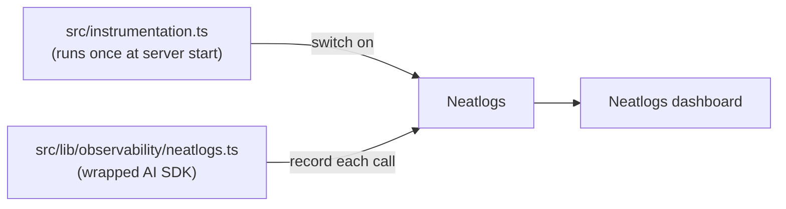

# Observability (Neatlogs) — Spec

What happens when someone asks the agent a question, recorded so you can look at
it later. This document explains it without assuming any prior knowledge.

**Status:** shipped. The agent's model calls and tool calls are recorded in
Neatlogs and can be read back from the terminal.

---

## The words, in plain language

- **Trace** — the record of _one_ request. When a visitor asks a question, lots
  of steps happen (the model thinks, searches the collection, writes an answer).
  A trace is the receipt that lists all of them together.
- **Span** — one line on that receipt: a single step, like "the model replied"
  or "searched the collection".

That is all "observability" means here: keeping a receipt for each question and
reading it when something looks wrong.

Neatlogs collects those receipts and shows them in a dashboard. It can also show
how much each question cost and how long it took.

---

## How it is wired

Two files. One to switch Neatlogs on, one to make the app's model calls visible.



### 1. Switch it on — `src/instrumentation.ts`

Next.js runs this file once when the server boots. It turns Neatlogs on and
gives the traces a label (`insights-agent`). If `NEATLOGS_API_KEY` is missing,
it prints a warning and the app runs exactly as before.

### 2. Make model calls visible — `src/lib/observability/neatlogs.ts`

Neatlogs cannot see AI SDK calls by itself. It gives us `wrapAISDK`, which
returns the same functions (`streamText`, `embedMany`, `generateObject`, …) with
recording added. Files that talk to a model import from this file, not from
`"ai"`.

Current call sites:

| File | Function | Used by |
| :--- | :--- | :--- |
| `src/lib/kb/agent.ts` | `streamText` | The Ask endpoint (`/api/insights/chat`) |
| `src/lib/kb/embed.ts` | `embedMany` | Retrieval search, and the backfill script |
| `src/lib/kb/writing-desk.ts` | `generateObject` | The Writing Desk (`/api/insights/desk`) |

If you add a new place that calls a model, import the function from
`@/lib/observability/neatlogs` instead of from `"ai"`.

One detail worth knowing: the AI SDK drops a prompt passed as `system` before it
reaches the trace. The agent passes its prompt as `instructions` so it appears.
(https://docs.neatlogs.com/integrations/vercel-ai)

---

## Environment variables

These live in `.env` (never committed).

| Variable | Used by | What it is |
| :--- | :--- | :--- |
| `NEATLOGS_API_KEY` | The app | Lets the app send traces. Dashboard → Settings → API keys. |
| `NEATLOGS_TOKEN` | You, in the terminal | Optional. Lets the CLI read traces back. Dashboard → Settings → Service accounts (role **Project Viewer**, scope `observability:read`). The app never uses it. |

Without `NEATLOGS_API_KEY`, tracing is off and nothing else changes.

Docs:

- TypeScript SDK: https://docs.neatlogs.com/sdk/typescript
- Vercel AI SDK: https://docs.neatlogs.com/integrations/vercel-ai
- CLI: https://docs.neatlogs.com/cli

---

## Reading a trace back

Neatlogs' own API key only sends data; it cannot read it. That is why reading
traces needs the separate `NEATLOGS_TOKEN`.

```bash
# Load the credentials without printing them.
set -a; . ./.env; set +a

HOST="https://app.neatlogs.com"
PROJECT="<project id>"   # from `projects list`, below

# Find the project id (once).
env -u NEATLOGS_PROJECT_ID neatlogs --host "$HOST" --credential-source token projects list --json

# List recent traces.
neatlogs --host "$HOST" --credential-source token --project "$PROJECT" traces list --limit 20 --json

# Read one trace and every span inside it.
neatlogs --host "$HOST" --credential-source token --project "$PROJECT" traces get <trace-id> --json
neatlogs --host "$HOST" --credential-source token --project "$PROJECT" traces spans list <trace-id> --limit 50 --json
```

`--credential-source token` makes the CLI use `NEATLOGS_TOKEN` only, ignoring
the app's `NEATLOGS_API_KEY`.

### Matching a trace to a question

Traces are ordered newest-first. To be sure which trace belongs to the question
you just asked, ask something you can recognise in the text (for example, start
the question with a unique word) and find it in the newest trace.

---

## Local checks

Two commands run before trusting the wiring. Neither needs the app running:

```bash
set -a; . ./.env; set +a
yarn run neatlogs doctor --local --json   # checks the installed SDK; no network
yarn run neatlogs doctor --probe --json   # sends one test trace and reads it back
```

`--local` proves the SDK works. `--probe` proves traces go out to Neatlogs and
come back. Neither proves the app itself is traced — that is what running a real
question and reading its trace (above) is for.

---

## Not covered

- **Scripts in `scripts/`** (`kb-ask`, `kb-trace`, classification, …) call the AI
  SDK directly and do not load `instrumentation.ts`, so they are not traced.
  They are development tools, not part of the running site.
- **One label for the whole app.** `workflowName` is set once at startup, so
  every trace shows under `insights-agent`. Distinguishing the Ask agent, the
  Writing Desk and search into separate workflows would need extra setup
  (https://docs.neatlogs.com/sdk/multiple-workflows).
