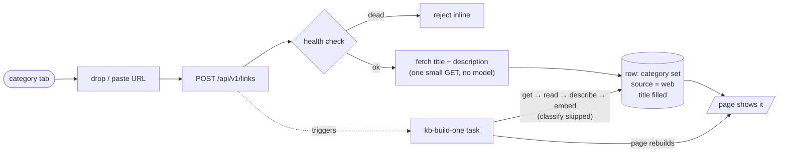

# On-Site Link Intake — Spec

Add a link from the insights page: pick a category tab, drop the URL. The category is
chosen by hand, so the pipeline's category guess is skipped. Everything else runs.

Pipeline background: [`insights-rebuild.md`](./insights-rebuild.md).
Table + admin auth: [`links-registry-and-api.md`](./links-registry-and-api.md).

---

## 1. How it works



Each pipeline stage runs only when its columns are empty, and **classify is the only
stage that decides a category**. A hand-picked category means that one call is skipped;
`get`, `read` (title/description/markdown), `describe` (summary + topics) and `embed` all
run. The route fetches the title and description itself, so the card is correct the moment
it appears; the task then fills in markdown, summary and embeddings.

---

## 2. Columns

No new column.

| Intake | `source` | `channel` | Classified? |
| :--- | :--- | :--- | :--- |
| Discord | `discord` (default) | the Discord channel name | yes |
| On-site | `web` | `null` | no |

- `source` is the intake record. `web` means a person filed it by hand.
- `channel` keeps its meaning (the Discord channel it was dropped in). An on-site row had
  no Discord channel, so the column becomes nullable.
- `channel` is also **removed from search results**. Search ranks by meaning and filters
  by category; carrying a Discord channel through it is a leftover from when the page
  grouped by channel. Remove it from `SearchHit`, the search query, the agent tool
  output, `Match` in the Curio client, and the PostHog capture.

---

## 3. Intake route — `POST /api/v1/links`

Admin-gated like `/api/v1/links/hide`.

1. Validate `{ url, category }` (zod; category from `CATEGORIES`).
2. `checkUrlHealth` — reject `dead`, keep the final URL.
3. Fetch the page's title and description from its HTML (`<title>`, `og:title`,
   `og:description` / `meta[name=description]`) — one GET capped at ~64KB, no model, no
   browser. The card needs a title at insert time; waiting on the pipeline for it is
   unnecessary.
4. Upsert by `url_key`. New row: `source='web'`, `channel=null`, `discordId=null`,
   `addedAt=now()`, `readStatus='pending'`, the chosen category, the fetched title and
   description. Existing row: set the category; if it changed, clear `summary` and
   `analyzedAt` but keep `markdown`.
5. Trigger the pipeline task for this row.
6. Revalidate the page.

Add `addLinkRequestSchema` to `api-schemas.ts` and the path to `openapi.ts` (tag `admin`).

---

## 4. Automation

The route inserts the row and returns. A Trigger.dev task then does the reading work for
that one link:

```
kb-build-link({ linkId })
  → load the row
  → run the same pipeline (get → read → describe → embed, classify skipped)
  → tell the site to rebuild its cached page
```

One link added = one run. The task is triggered once per link and handles only that link;
it never scans the table. The weekly `kb-refresh` is a rotation over the whole collection
and cannot target one link, so this is a separate task — but it reuses the same
`buildLink`, so no pipeline is duplicated. A queue caps how many run at once, so adding
fifty links in an hour queues them instead of firing fifty model calls at once:

```ts
const kbBuildQueue = queue({ name: "kb-build-link", concurrencyLimit: 3 });
```

Why a task and not the route: reading a page takes seconds and sometimes needs a real
browser, and a web request should stay fast. Trigger.dev runs the same code the local
script runs.

**Rebuilding the page.** The insights page caches its link list for 5 minutes. When the
task finishes, it calls the existing `/api/revalidate` endpoint, which tells Next.js to
throw that cache away and rebuild now, so the page shows the real title without waiting
for the cache to expire. The Discord intake already does this.

**What Trigger.dev cannot do.** Some pages only render with JavaScript. Reading those
needs headless Chrome, which only the local script has (`--render`). Those links stay
thin until you run the script; everything else runs automatically.

**The local script stays** for full rebuilds, reclassifying old rows, and the Chrome
fallback.

**Prerequisite:** the deploy must mark `jsdom` external in `trigger.config.ts`, or the
build fails on `./xhr-sync-worker.js`.

---

## 5. Terminal visibility

Running the script locally should show what is happening. Add an optional `onStage`
callback to `buildLink` (`"get" | "read" | "understand" | "embed"`).

- On a terminal: a live block, one row per link in flight:
  ```
  kb-build · 42 to process · 4 at a time
  brandur.org/minimalism     embed       11 passages
  example.com/paywalled      understand  describe
  broken.example             get         fetching
  ```
- Piped to a file or CI: one plain line per stage change.
- Always, a completion line per link:
  ```
  ✓ 12/42  brandur.org/minimalism   article  · 11 passages · 3.2s
  ⚠ 13/42  example.com/paywalled    article  · thin, 1 passage · 1.8s
  ✗ 14/42  broken.example                      failed · 0.9s
  ```
- Final tally: ok / thin / failed / understood / passages / errors + elapsed time.

No new dependency. Without a terminal it degrades to plain lines.

---

## 6. UI

Admin only, and only when a real category tab is active.

- A compact row under the app bar: input ("Drop or paste a link into Articles") + Add.
- Accepts paste, Enter, and drag-and-drop (`text/uri-list` / `text/plain`), with a
  drag-over highlight.
- Inline states: idle → submitting → success → error (invalid / dead / rate-limited).
  No alerts. On success, refresh and keep focus for the next drop.
- Reuse the existing admin chrome: `loseAdminSession` on 401, `useFeedback` on press.

**Ordering.** The client currently sorts by Discord snowflake `id`, which on-site rows do
not have. Add `addedAt: number` to `InsightsClientLink` and sort by it in
`sortByNewestId` / `sortByOldestId` (callers: `InsightsList`, `page.tsx`, `rss.xml`,
`llms-full.txt`).

**Empty title.** A page with no `<title>`/OG tags falls back to the hostname in the card.

---

## 7. Edge cases

| Case | Behaviour |
| :--- | :--- |
| URL already present | upsert; set category; clear summary only if it changed |
| Provably dead | rejected before insert |
| Bot-walled (`uncheckable`) | accepted; pipeline marks it thin/failed, keeps the description |
| Non-admin | no drop box; 401 |
| Manual row, later reclassify | describe re-runs; category is never touched |

---

## 8. Build order

1. `channel` nullable; remove `channel` from search and its consumers.
2. `understandPage` optional category; `buildLink` skips classify when `source='web'`;
   `LinkRow` gains `source`.
3. `kb-build` selection also picks rows with no summary.
4. `addedAt` ordering.
5. `onStage` callback + terminal output.
6. `POST /api/v1/links` + schema + OpenAPI.
7. `kb-build-link` task + queue + trigger from the route + `jsdom` external.
8. Drop box UI.
