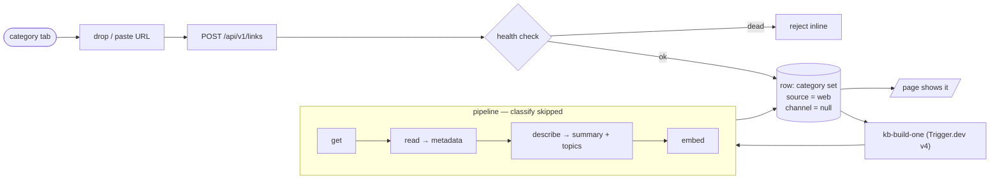

# On-Site Link Intake — Spec

Add a link from the insights page: pick a category tab, drop the URL. You already know
where it belongs, so the model's category guess is skipped. Every other stage runs.

**Status:** proposed. Pipeline background: [`insights-rebuild.md`](./insights-rebuild.md).
Table + admin auth: [`links-registry-and-api.md`](./links-registry-and-api.md).

---

## 1. The one fact this rests on

The pipeline is already modular: each verb skips itself when its columns are set, and
**classify is the only verb that decides the category**. Pick the category yourself and
that one call disappears; `get`, `read`, `describe` (summary + topics) and `embed` are
untouched.



---

## 2. Columns: reuse, don't add

No `category_source`. The existing `source` column already means "which intake produced
this row" — it has just never been read. Use it:

| Row | `source` | `channel` | classify? |
| :--- | :--- | :--- | :--- |
| Discord | `discord` (default) | the Discord channel name | yes |
| On-site | `web` | `null` | **no** |

- `source = 'web'` is both the intake record and the "filed by hand" signal.
- `channel` keeps its exact meaning (the Discord channel). An on-site row had no Discord
  channel, so the honest value is `null`. That means one migration: drop `NOT NULL` on
  `channel`. No new column, no sentinel strings.
- Type ripple: `channel` becomes `string | null` in `search.ts`, `links/queries.ts`,
  `inspect.ts`, and `Match` in the Curio client. It is only shown in analytics, so null
  is harmless.

If a future web form ever lets the model classify, revisit then. Not now.

---

## 3. Pipeline changes

1. **`understandPage`** gains an optional `category`. When present, skip `classifyPage`
   and call `describePage` with it directly.
2. **`buildLink`** (`store.ts`): if `source === 'web'` and the stored category is valid,
   pass it in and do **not** apply `category-overrides.json` (the on-site choice is the
   newer human decision). `LinkRow` gains `source`.
3. **`needsUnderstand`** adds `!link.summary`, so a manual row whose summary was cleared
   (recategorised, or a crash between read and describe) is picked up again.
4. **`kb-build` selection** becomes `markdown is null OR category is null OR summary is
   null`, so a half-finished manual row is never skipped forever.

---

## 4. Automation (Trigger.dev v4)

v3 is deprecated and not running. Migration done (see §7). The new intake is automatic:

- **New task `src/trigger/kb-build-one.ts`** — payload `{ linkId }`, loads the row, calls
  `buildLink`, then hits `/api/revalidate` so the enriched card replaces the placeholder.
  No `render` flag, so JS-heavy pages stay thin until a local `--render` run.
- **The route triggers it** with `tasks.trigger("kb-build-one", { linkId })` (string id,
  so the route never imports defuddle/jsdom).
- **The local script stays**, for backfills, `--stale` reclassify, `--render` retries and
  debugging. It is no longer the only way a link gets read.

Cost: Trigger.dev free-tier compute, plus the same model calls as before. No Vercel cost
beyond the one route call.

---

## 5. Terminal visibility

The script should say what it is doing. Add an optional `onStage` callback to `buildLink`
(`"get" | "read" | "understand" | "embed"`), and:

- **TTY:** a small live block, one row per in-flight link, redrawn with ANSI:
  ```
  kb-build · 42 to process · 4 at a time
  brandur.org/minimalism     embed       11 passages
  example.com/paywalled      understand  describe
  broken.example             get         fetching
  ```
- **Non-TTY (CI/logs):** one plain line per stage transition, no cursor games.
- **Per-link completion line** always:
  ```
  ✓ 12/42  brandur.org/minimalism   article  · 11 passages · 3.2s
  ⚠ 13/42  example.com/paywalled    article  · thin, 1 passage · 1.8s
  ✗ 14/42  broken.example                      failed · 0.9s
  ```
- **Final tally** as today: ok / thin / failed / understood / passages / errors, plus
  elapsed time.

No new dependency. If stdout is not a TTY, degrade to plain lines.

---

## 6. Route and UI

**Route** `POST /api/v1/links` (admin-gated like `/api/v1/links/hide`):

1. validate `{ url, category }` (zod; category from `CATEGORIES`);
2. `checkUrlHealth` — reject `dead`, keep `finalUrl`;
3. upsert by `url_key`: new row gets `source='web'`, `channel=null`, `discordId=null`,
   `addedAt=now()`, `readStatus='pending'`, the chosen `category`. Existing row: set
   category; if it changed, clear `summary` + `analyzedAt` (keep `markdown`);
4. trigger `kb-build-one`;
5. revalidate.

Add `addLinkRequestSchema` to `api-schemas.ts`, register the path in `openapi.ts` (tag
`admin`).

**UI** (`InsightsList.tsx`, admin only, only when a real category tab is active):

- a compact row under the app bar: input ("Drop or paste a link into Articles") + Add;
- accepts paste, Enter, and drag-and-drop (`text/uri-list` / `text/plain`), with a
  drag-over highlight;
- inline states: idle → submitting → success → error (invalid / dead / rate-limited).
  No alerts. On success `router.refresh()` and keep focus;
- reuse the existing admin chrome: `loseAdminSession` on 401, `useFeedback` on press.

**Ordering:** client links currently sort by Discord snowflake `id`, which is null for web
rows. Add `addedAt: number` to `InsightsClientLink` and switch `sortByNewestId` /
`sortByOldestId` to sort by `addedAt` (callers: `InsightsList`, `page.tsx`,
`rss.xml`, `llms-full.txt`). Correct regardless of this feature.

**Empty title:** a fresh row has no title until `read` runs. Fall back to the hostname in
the card when `title` is empty.

---

## 7. Trigger.dev v3 → v4 (done)

Only the import path and versions changed; none of the v4 breaking APIs (`init`,
`handleError`, `toolTask`, queues, lifecycle hooks, `batchTrigger`, `triggerAndWait`) were
in use.

- `src/trigger/{discord-links,kb-refresh,links-health}.ts` and `trigger.config.ts`:
  `@trigger.dev/sdk/v3` → `@trigger.dev/sdk`.
- `package.json`: `@trigger.dev/sdk` and `@trigger.dev/build` → `^4.7.4`; installed.
- `tsc --noEmit` clean.
- **Still required:** redeploy with the v4 CLI (`npx trigger.dev@latest deploy`) so the
  cron tasks resume; v4 uses the same project/secret.

---

## 8. Edge cases

| Case | Behaviour |
| :--- | :--- |
| URL already present | upsert; set category; clear summary only if it changed |
| Provably dead | rejected before insert |
| Bot-walled (`uncheckable`) | accepted; pipeline marks thin/failed, keeps description fallback |
| Non-admin | no drop box; 401 |
| Manual row, later `--stale` | describe re-runs; category never touched |
| Manual row vs `category-overrides.json` | manual wins |

---

## 9. Build order

1. Migration: `channel` nullable.
2. `understandPage` optional category + `buildLink` `source==='web'` branch + `LinkRow.source`.
3. `kb-build` selection filter.
4. `addedAt` ordering swap.
5. `onStage` callback + terminal output.
6. `POST /api/v1/links` + schema + OpenAPI.
7. `kb-build-one` task + trigger from the route.
8. Drop box UI.

Steps 1–4 are invisible and independently safe. 5 is the local-run visibility. 6 is
curl-usable before the UI. 7 makes it automatic. 8 is the visible feature.
